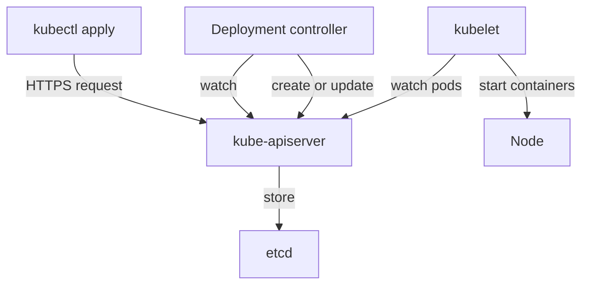

# Desired State, The API Server And Controllers

A platform team often needs thirty applications to look the same and stay that way. If each change is a list of commands that someone types, nobody can say afterwards what the system is supposed to look like. Declarative resource management solves this by storing the wanted result, not the steps. This part shows what a declaration is, who stores it and which component turns it into running containers.

## What a declaration is

A declaration is a document that describes the state you want. In Kubernetes it is a resource written in YAML or JSON. The document has a `kind` (the type of object, for example `Deployment`), a `metadata` block (name, namespace, labels) and a `spec` block. The `spec` (specification) holds the desired state, for example "run two copies of this container image".

An imperative command describes an action: "start a container", "add one more". An imperative history cannot be replayed safely, because a command such as "add one more" gives a different result each time. A declaration gives the same result each time, because it states the end state, for example "replicas: 3".

Start with a real declaration. The playground already runs `scout` in the `starfleet` namespace. Read its desired state and its observed state next to each other.

<!-- astrona:playground:renew -->

Print the `spec` of the `scout` Deployment and then its `status`:

```sh
kubectl -n starfleet get deployment scout -o jsonpath='{.spec.replicas}{"\n"}'
kubectl -n starfleet get deployment scout -o jsonpath='{.status.readyReplicas}{"\n"}'
```

The first command prints the number the declaration asks for. The second prints the number of pods that the Deployment controller currently counts as ready. Both print `1` after the playground is settled. They are different fields with different authors: you write `spec`, and a controller writes `status`.

## Who stores the declaration

The Kubernetes API server (`kube-apiserver`) is the only component that accepts and returns resources. It validates each request, checks authentication and authorization, runs admission controllers and then stores the object in etcd, the key-value database of the cluster. After the object is stored, nothing has happened to any container yet. The cluster only holds a record of intent.

This is the first contract of declarative management: the API server stores intent and returns it unchanged. A user who runs `kubectl get -o yaml` reads exactly the document that the API server holds, with additional fields that other components added, such as `status`, `uid` and `resourceVersion`.



The diagram shows that no component talks to another directly. Every component reads and writes through the API server, and etcd is behind it.

## Who turns intent into running containers

A controller is a program that runs a loop. It watches the API server for objects of one kind, compares the desired state in `spec` with what exists, and makes changes that reduce the difference. This loop is called reconciliation. The controllers of the built-in resources run inside `kube-controller-manager`.

The `scout` Deployment shows the chain. The Deployment controller sees a Deployment and creates a ReplicaSet that carries the pod template. The ReplicaSet controller sees the ReplicaSet and creates the number of Pod objects in `spec.replicas`. The scheduler (`kube-scheduler`) assigns each unscheduled Pod to a node. The kubelet on that node sees a Pod assigned to it and asks the container runtime to start the containers.

List the three objects that belong to `scout`:

```sh
kubectl -n starfleet get deployment,replicaset,pod -l app=scout
```

The output has one Deployment, one ReplicaSet with a generated name that ends in a hash, and one Pod whose name starts with the ReplicaSet name. Each object was created by the controller above it, not by you.

## The reconciliation loop in action

A controller does not run a script once. It keeps the loop running, so it also repairs changes that nobody declared. Delete the pod that belongs to `scout` and observe what happens.

```sh
kubectl -n starfleet delete pod -l app=scout
kubectl -n starfleet get pods -l app=scout
```

The first command prints `pod "scout-..." deleted` with the generated name. The second command shows a pod with a new name. The ReplicaSet controller saw that the ReplicaSet wanted one pod and found none, so it created a new Pod object. You did not run any create command.

Now change the desired state. Edit `spec.replicas` through the scale subresource and watch the controller follow:

```sh
kubectl -n starfleet scale deployment scout --replicas=3
kubectl -n starfleet rollout status deployment scout
kubectl -n starfleet get pods -l app=scout
```

The `scale` command prints `deployment.apps/scout scaled`. The rollout command waits until the new pods are ready. The last command lists three pods. Only the number in `spec.replicas` changed. The ReplicaSet controller did the work.

## Sufficient intent

A declaration is sufficient when the controller can reach the end state without more input from a person. A Deployment that has a pod template with an image, a `selector` and a `replicas` count is sufficient for the Deployment controller to produce running pods. A Deployment without `selector` is rejected by the API server, because the controller could not find the pods that belong to it.

Sufficient intent also has limits. The `scout` declaration does not say which node runs the pod, which IP address the pod gets or which port on the node is used. Those values are left to the scheduler, the network plugin and the kubelet. A declaration should state what the user cares about and leave open what the platform may choose. If a declaration states too much, for example a fixed node name, the controller can no longer move the pod when the node fails.

## Declarative management versus a script in version control

Storing `kubectl scale` commands in a Git repository does not make management declarative. The repository would hold a sequence of actions whose result depends on the cluster state at the moment of running. Running the same script twice scales twice. A declarative repository holds the resource documents themselves, and applying the same document twice leaves the cluster unchanged.

Return the playground to one replica by declaring it:

Save this as `scout-deployment.yaml`:

```yaml
apiVersion: apps/v1
kind: Deployment
metadata:
  name: scout
  namespace: starfleet
  labels:
    app: scout
spec:
  replicas: 1
  selector:
    matchLabels:
      app: scout
  template:
    metadata:
      labels:
        app: scout
    spec:
      serviceAccountName: scout
      containers:
        - name: scout
          image: ghcr.io/stefanprodan/podinfo:6.15.0
          ports:
            - name: http
              containerPort: 9898
```

Apply it:

```sh
kubectl apply -f scout-deployment.yaml
```

Then check the result:

```sh
kubectl -n starfleet get deployment scout -o jsonpath='{.spec.replicas}{"\n"}'
```

The apply command prints `deployment.apps/scout configured` because the live object differed from the file. Applying the same file a second time prints `deployment.apps/scout unchanged`. This property, called idempotence, is what lets a platform run the same apply again and again without a risk of double changes.

## What you know now

A declaration states the end state in `spec`. The API server stores it, controllers watch it, and each controller closes the gap between `spec` and the real world in a loop. You saw that deleting a pod is repaired and that changing one number changes the number of pods. The open question is where the declaration comes from: with many applications and environments, a team writes a template and produces each document from it, which is called rendering.

## Common pitfalls

> [!WARNING]
> A resource that the API server accepted is not a resource that works. The API server validates the shape of the document, not whether the image exists or whether the pod can start. Read `status` and the events to see what the controller achieved.
> A `kubectl scale` or `kubectl edit` changes the live object but not your file. The next `kubectl apply` of the file overwrites that change, so keep the file as the source of truth.
