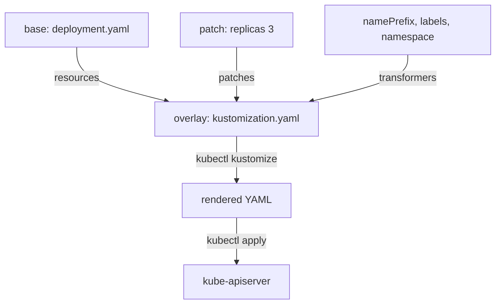

# Rendering Declarations With Kustomize

One Deployment document is easy to keep correct. Ten documents for the same application in three environments are not, because each copy drifts from the others. Rendering produces the final documents from a small set of inputs, so a team edits one source and generates the copies. This part shows the inputs of a render, how Kustomize combines them and how to read the result before it reaches the cluster.

## Inputs and output of a render

Rendering is a function. The inputs are documents and settings: a base resource, a list of changes and some values. The output is a set of complete resources that the API server accepts. The function has no memory and does not contact the cluster, so the same inputs always give the same output. That property makes a render reviewable: two people can run it and compare the result.

Kustomize is a rendering tool that is built into `kubectl`. It reads a directory that contains a file named `kustomization.yaml`. That file lists resources and the transformations to apply to them. Kustomize does not use a template language. It edits plain YAML, so every input file is a valid resource on its own.

Two names matter. A base is a directory with complete resources and a `kustomization.yaml`. An overlay is a directory whose `kustomization.yaml` points at a base and adds changes for one purpose, for example one environment or one team.



The diagram shows that the overlay is the single entry point. The base is never edited for one environment, and the rendered YAML is the only thing that reaches the API server.

## A base and an overlay

Build the smallest useful example. The base holds the `scout` Deployment. The overlay changes the namespace, the name and the replica count for a team in `outpost`.

<!-- astrona:playground:renew -->

Create a directory for the base and save this as `base/deployment.yaml`:

```yaml
apiVersion: apps/v1
kind: Deployment
metadata:
  name: scout
  labels:
    app: scout
spec:
  replicas: 1
  selector:
    matchLabels:
      app: scout
  template:
    metadata:
      labels:
        app: scout
    spec:
      containers:
        - name: scout
          image: ghcr.io/stefanprodan/podinfo:6.15.0
          ports:
            - name: http
              containerPort: 9898
```

Save this as `base/kustomization.yaml`:

```yaml
apiVersion: kustomize.config.k8s.io/v1beta1
kind: Kustomization
resources:
  - deployment.yaml
```

The base has no namespace. That is intentional: the base describes the application, and the overlay decides where it runs. Now create the overlay.

Save this as `overlays/outpost/kustomization.yaml`:

```yaml
apiVersion: kustomize.config.k8s.io/v1beta1
kind: Kustomization
namespace: outpost
namePrefix: outpost-
resources:
  - ../../base
labels:
  - pairs:
      tier: edge
    includeSelectors: true
patches:
  - target:
      kind: Deployment
      name: scout
    patch: |-
      - op: replace
        path: /spec/replicas
        value: 2
```

The `namespace` and `namePrefix` fields are transformers: they rewrite every resource. The `labels` field adds `tier: edge` to every resource, and `includeSelectors: true` also adds it to selectors and pod templates. The `patches` entry is a JSON Patch (a list of operations, defined in RFC 6902) that targets the Deployment by kind and name.

## Read the render before you apply it

Render the overlay and read the result:

```sh
kubectl kustomize overlays/outpost
```

The command writes YAML to the terminal and does not contact the cluster. In the output the Deployment is called `outpost-scout`, its namespace is `outpost`, `replicas` is `2`, and the label `tier: edge` appears on the Deployment, in `spec.selector.matchLabels` and in the pod template labels. Reading this output is the review step: it shows what the API server will receive.

Compare the render with the live cluster before the first apply. The `diff` command asks the API server what would change and prints a diff:

```sh
kubectl diff -k overlays/outpost
```

Because `outpost-scout` does not exist yet, the whole Deployment appears as an addition. The command exits with status 1 when there are differences, which is how a pipeline detects a pending change.

Apply the overlay:

```sh
kubectl apply -k overlays/outpost
```

The command prints `deployment.apps/outpost-scout created`. Apply it a second time and the output ends in `unchanged`, because rendering is deterministic and the live object already matches.

## Changing an input changes the output

The value of rendering appears when an input changes. Change the replica count in the overlay patch from `2` to `3`, render again and look at the diff:

```sh
kubectl diff -k overlays/outpost
```

The diff shows one changed line: `replicas`. Nothing else in the Deployment changes. The base stayed the same, and the patch is the only place where the number lives. In a copy-and-edit workflow the same change needs an edit in every copy.

A second input is the image. Kustomize has an `images` field that rewrites the image name or tag in every container, so a release only edits one line:

```yaml
images:
  - name: ghcr.io/stefanprodan/podinfo
    newTag: 6.15.0
```

Add the block to the overlay `kustomization.yaml`, render, and the container image in the output uses the tag from the `images` field. The field replaces the tag wherever the image name matches.

## What a render cannot do

Rendering produces documents. It does not know whether the documents work. Kustomize does not check that an image exists, that a Service selector matches a pod, or that a namespace was created before the objects inside it. If the overlay sets `namespace: outpost` and the namespace does not exist, `kubectl apply -k` fails at the API server with a message that the namespace is not found. The render itself succeeded.

A render also has to match the controller that will read it. The Deployment controller expects `spec.selector` to match the labels of the pod template. The `labels` transformer with `includeSelectors: true` keeps them aligned. If you add labels through a patch to only the pod template, the selector and the template no longer match, and the API server rejects the Deployment.

Finally, a render carries all of its inputs in files. A value that someone types on the command line, such as `kubectl set image` after the apply, is a second input that the files do not know. The next apply from the files removes it, which is the topic of drift.

## What you know now

A render combines a base, patches and transformers into complete resources, and the same inputs always give the same output. You rendered an overlay, reviewed the output with `kubectl kustomize`, compared it to the cluster with `kubectl diff -k` and applied it with `kubectl apply -k`. The open question is what happens after the apply: who owns each field of the live object when a person and a controller both write to it.

## Common pitfalls

> [!WARNING]
> `kubectl apply -k` applies a directory with a `kustomization.yaml`. `kubectl apply -f` on the same directory ignores that file and applies every YAML file in it, which skips the overlay.
> Changing `namePrefix` renames the objects. Kubernetes sees a new object, creates it and leaves the old one, so remove the old object explicitly.
> Selectors are immutable on a Deployment. Adding a label with `includeSelectors: true` to an existing Deployment fails with an error about an immutable field; create the object under a new name instead.
