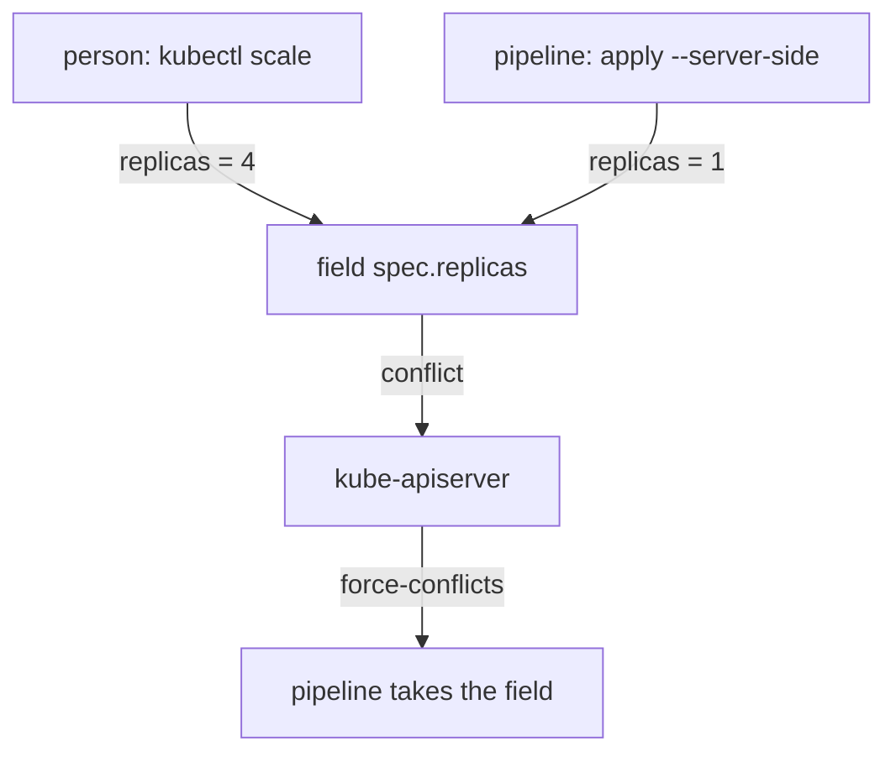

# Ownership, Drift And Field Managers

A declaration is only useful if the live object keeps matching it. In a real cluster several writers touch the same object: a person with `kubectl`, a pipeline, an autoscaler and the controllers themselves. This part shows how Kubernetes records who owns an object and who owns each field, what drift is, and how a controller reports whether it reached the desired state.

## Owner references

An owner reference is a field in `metadata.ownerReferences` that names the object that owns this one. Controllers set it when they create objects. The ReplicaSet of `scout` has an owner reference to the `scout` Deployment, and each Pod has an owner reference to the ReplicaSet.

Owner references define two behaviors. First, when the owner is deleted, the garbage collector (a controller in `kube-controller-manager`) deletes the dependents. Second, a controller only manages objects that it owns, so it does not take over a Pod that another controller created.

<!-- astrona:playground:renew -->

Print the owner of a `scout` pod:

```sh
kubectl -n starfleet get pod -l app=scout -o jsonpath='{.items[0].metadata.ownerReferences[0].kind}{"\n"}'
```

The command prints `ReplicaSet`. A Pod that you create by hand has no owner reference, and no controller recreates it. Create one and delete it to see the difference:

```sh
kubectl -n starfleet run bare-shuttle --image=curlimages/curl:8.22.0 --command -- sleep 3600
kubectl -n starfleet delete pod bare-shuttle
kubectl -n starfleet get pod bare-shuttle
```

The first command prints `pod/bare-shuttle created`. After the delete the last command prints an error that the pod is not found. No controller owned the pod, so nothing recreated it. A declaration is only self-healing when a controller owns the object.

## What drift is

Drift is a difference between the declared desired state and the live state that no declaration explains. The cause is a write that did not come from the source of truth: an engineer scales a Deployment in an emergency, or edits an image with `kubectl edit`. The live object works, but the repository no longer describes it.

Controllers repair drift in the objects they own, but only below their level. The ReplicaSet controller repairs a deleted Pod because the ReplicaSet declares one Pod. No controller repairs a changed Deployment, because the changed Deployment is itself the declaration. Drift in the top-level object is invisible to the cluster and needs a comparison with the source of truth.

Create drift on purpose. First write the declaration of `scout` to a file. Save this as `scout-deployment.yaml`:

```yaml
apiVersion: apps/v1
kind: Deployment
metadata:
  name: scout
  namespace: starfleet
  labels:
    app: scout
spec:
  replicas: 1
  selector:
    matchLabels:
      app: scout
  template:
    metadata:
      labels:
        app: scout
    spec:
      serviceAccountName: scout
      containers:
        - name: scout
          image: ghcr.io/stefanprodan/podinfo:6.15.0
          ports:
            - name: http
              containerPort: 9898
```

Then scale `scout` by hand and compare the live object with the file:

```sh
kubectl -n starfleet scale deployment scout --replicas=4
kubectl diff -f scout-deployment.yaml
```

The diff shows `replicas` changing from `4` back to `1`. The command exits with status 1, which means a difference exists. Apply the file to remove the drift:

```sh
kubectl apply -f scout-deployment.yaml
```

The Deployment controller then scales the ReplicaSet back to one pod. The file won because apply compares it with the live object.

## Field managers

Kubernetes tracks who wrote each field. Each write carries a field manager name, and the API server stores the owned fields in `metadata.managedFields`. Server-side apply (SSA) uses this record: when you apply a document with `--server-side`, the API server merges it and keeps track of which fields your manager owns.

Show the managers of the `scout` Deployment:

```sh
kubectl -n starfleet get deployment scout --show-managed-fields -o jsonpath='{range .metadata.managedFields[*]}{.manager}{" "}{.operation}{"\n"}{end}'
```

The output lists one line for each manager that wrote to the object, for example `kubectl-client-side-apply Update` for your apply, `kubectl Update` for the scale command and `kube-controller-manager Update` for the controller that writes `status`. The exact list depends on what ran before.

When two managers claim the same field with different values, the API server reports a conflict. A server-side apply refuses to overwrite a field that another manager owns, unless the request sets `--force-conflicts`. This turns silent overwriting into an explicit decision.



The diagram shows that the second writer is stopped until it takes ownership on purpose.

## Taking ownership with server-side apply

Run a server-side apply of the same file under a named manager. The scale command made `kubectl` the owner of `replicas`, so the first attempt conflicts:

```sh
kubectl -n starfleet scale deployment scout --replicas=4
kubectl apply --server-side --field-manager=platform-team -f scout-deployment.yaml
```

The apply fails with an error that says there is a conflict with the manager `kubectl` on `.spec.replicas`. Nothing changed. Decide that the file is the truth and force the apply:

```sh
kubectl apply --server-side --force-conflicts --field-manager=platform-team -f scout-deployment.yaml
```

The command prints `deployment.apps/scout serverside-applied`. The field `spec.replicas` has the value `1` again and now belongs to `platform-team`. A later scale command by another person conflicts the same way, so the ownership is visible.

## Status: did the controller reach the intent

A controller reports its progress in `status`. For a Deployment the important fields are `observedGeneration`, `replicas`, `updatedReplicas`, `readyReplicas` and `conditions`. The API server increments `metadata.generation` each time `spec` changes. A controller copies the generation it processed into `status.observedGeneration`. If the two numbers differ, the controller has not yet seen the latest declaration, so the status describes an older intent.

Check both numbers and the conditions:

```sh
kubectl -n starfleet get deployment scout -o jsonpath='{.metadata.generation} {.status.observedGeneration}{"\n"}'
kubectl -n starfleet get deployment scout -o jsonpath='{range .status.conditions[*]}{.type}={.status}{"\n"}{end}'
```

After a settled rollout both numbers are equal. The conditions include `Available=True` and `Progressing=True`. A `Progressing=False` condition with the reason `ProgressDeadlineExceeded` means that the controller could not finish the rollout in the time allowed, for example because an image cannot be pulled.

## What a controller cannot infer

A controller can only act on what the declaration and the cluster contain. It cannot infer that `scout` should be the same version as in another environment, that a Secret should exist, or that a change is dangerous. It also cannot restore a deleted top-level object: if someone deletes the `scout` Deployment, the garbage collector removes its pods, and nothing recreates the Deployment because nothing else declares it. Recreating a top-level object needs a copy of its declaration outside the cluster, which is the reason teams keep the documents in version control and apply them from there.

## What you know now

Owner references link objects to the controller that repairs them. Drift is a change with no matching declaration, and only the top-level declaration can remove it. Field managers record which writer owns each field, and server-side apply turns an overwrite into a visible conflict. The status fields tell whether a controller has processed the latest declaration. The open question for a platform is how to apply the declarations automatically and continuously instead of by hand.

## Common pitfalls

> [!WARNING]
> `--force-conflicts` takes fields from other managers. Use it only when the file is the truth, and name the manager so the ownership stays readable.
> A matching `replicas` count does not mean a successful rollout. Compare `metadata.generation` with `status.observedGeneration`, and read the conditions.
> A manually created pod has no owner and no repair. Use a Deployment for anything that must stay running.
