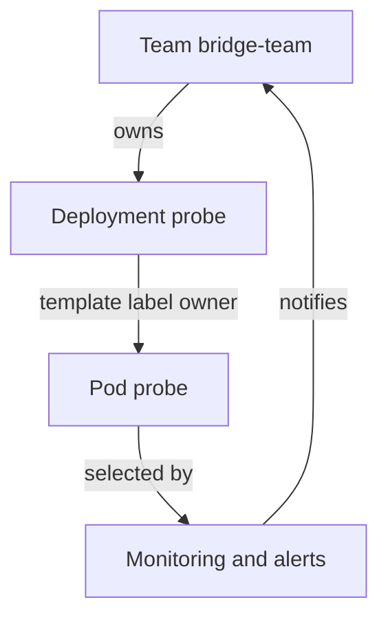

# Shared Ownership And Platform Enablement

When one team writes code and another team runs it, a failure at night starts with a search for the person who knows the service. DevOps removes that gap by giving the team that builds a service a share of the responsibility for running it, and by giving that team the tools to do it. A platform team supports this by offering supported services, not by taking over every task. This part defines shared ownership, shows how a cluster records it and explains where the platform team's responsibility ends.

## What DevOps means in practice

DevOps is a set of working practices that joins development (writing and changing software) and operations (running it in production). The practices include shared ownership of a service from design to production, automated build and deployment, and short feedback loops from production back to the people who change the service. DevOps is not a job title and not a tool.

Shared ownership does not mean that everyone does everything. It means that a named team answers for the service, can see how it behaves and can change it without a ticket to another team. If the team cannot see the logs, it cannot own the incident. If the team cannot deploy, it cannot own the fix.

DevSecOps adds security to the same loop. Security checks run during development and delivery, for example image scanning, policy checks at deployment and least-privilege access, instead of a review at the end. The responsibility for them is shared in the same way.

## Ownership must be visible in the system

Ownership that exists only in a document goes out of date. A platform records it on the objects themselves with labels and annotations. A label is a key-value pair in `metadata.labels` that tools can select on. An annotation is a key-value pair in `metadata.annotations` that holds information for people and tools but is not used to select objects.

Start with the playground. Read the labels that the example Deployments carry now:

<!-- astrona:playground:renew -->

```sh
kubectl -n starfleet get deployments --show-labels
```

The Deployments have an `app` label and nothing that says which team owns them. An on-call engineer who finds a failing `probe` cannot learn from the cluster whom to ask. Add the ownership to the pod template, so that every pod carries it, and to the Deployment metadata:

```sh
kubectl -n starfleet label deployment probe owner=bridge-team
kubectl -n starfleet annotate deployment probe platform.example/contact=bridge-team@starfleet.example
```

The commands print `deployment.apps/probe labeled` and `deployment.apps/probe annotated`. Now a selector can find everything one team owns:

```sh
kubectl -n starfleet get deployments -l owner=bridge-team
```

The output lists only `probe`. The label on the Deployment does not reach its pods, because pods take their labels from the pod template. For pod-level selection, such as log queries and alerts that select pods, the label belongs in `spec.template.metadata.labels`. Changing the template creates a new ReplicaSet and a rollout.

## Ownership labels in the pod template

Patch the template of `probe` so that the pods carry the label too:

```sh
kubectl -n starfleet patch deployment probe --type=merge -p '{"spec":{"template":{"metadata":{"labels":{"owner":"bridge-team"}}}}}'
kubectl -n starfleet rollout status deployment/probe
kubectl -n starfleet get pods -l owner=bridge-team
```

The patch prints `deployment.apps/probe patched`, and the rollout command waits until the new pod is ready. The last command lists the new `probe` pod. A single label now lets monitoring, cost reports and incident tools route work to the right team.



The diagram shows that the label is the link in both directions: it identifies the owner, and it lets the signals from the pod reach the owner.

## What a platform team provides

A platform team treats the shared services that product teams need as a product. The users are the product teams. The platform team builds supported paths, such as a deployment template, a logging setup and a policy baseline, and it runs the services under them.

The platform team does not transfer all responsibility to itself, and it does not push all of it to the product teams. Responsibilities divide along a boundary that is written down:

- The platform team owns the cluster, the network, the base images, the deployment pipeline and the policies that run on every workload.
- The product team owns the application code, its configuration, its dependencies, its alerts and the decision when to release.
- Both teams own the interface between them: the template, the quotas and the documentation.

When the boundary is vague, two failure modes appear. If the platform team takes everything, it becomes a queue that slows every change. If the product teams take everything, each team rebuilds the same deployment setup and security checks and does them differently.

## Enablement versus handover

Enablement means a team can do the work itself with supported tools. Handover means the work is passed to another team. A product team that opens a ticket to get a namespace has been handed over to the platform team's queue. A product team that creates a namespace from a template through a supported interface has been enabled.

Check what the `bridge-team` could do without a ticket in this cluster. Ask the API server whether a user in that group may create a Deployment in `starfleet`:

```sh
kubectl auth can-i create deployments -n starfleet --as=jane --as-group=bridge-team
```

The answer is `no`, because no role is bound to the group. Enablement here means that the platform team defines a Role and a RoleBinding for the team once, so that the team deploys by itself within the boundary. The team then needs signals that tell it whether a deployment worked.

## Limits of the practice

Shared ownership works only when the owner can act. A team that owns a service but cannot read its logs, change its configuration or roll it back owns only the blame. A label that names an owner does not create the responsibility: the team must agree to the ownership, and the on-call process must exist.

Labels have limits too. Kubernetes does not check that `owner` names a real team, and it does not stop a person from changing the label. Platforms add a policy that requires the label and a check that its value comes from an allowed list.

## What you know now

DevOps shares ownership of a service across build and run, and DevSecOps adds security to the same loop. A platform records the ownership on the objects with labels and annotations, and puts the labels in the pod template so that pods carry them. The platform team offers supported paths, and the boundary of responsibility must be explicit. The open question is how the owning team learns whether its change worked: the answer is feedback.

## Common pitfalls

> [!WARNING]
> Putting a label only on the Deployment does not label its pods. Pod selection needs the label in the pod template.
> Changing the pod template starts a rollout, so label changes to pods are not free. Plan them together with other changes.
> Ownership labels without an on-call agreement are decoration. The label must point to a team that accepted the work.
