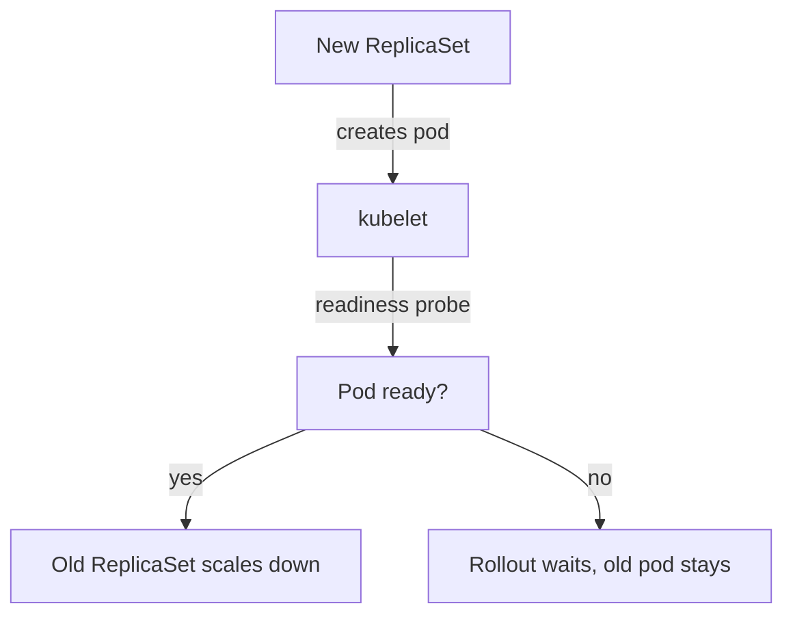

# Feedback Signals: Probes, Rollouts And Rollback

A team that owns a service needs to know quickly whether a change made it better or worse. Feedback is the information that flows from the running system back to the people who changed it. In Kubernetes the first feedback signals are health probes, the rollout status and the events. This part shows what each signal says, which component produces it and how a failed rollout is stopped and reversed.

## Probes: what the kubelet asks the container

A probe is a check that the kubelet (the agent on each node) runs against a container. Kubernetes has three kinds. A startup probe says whether the application has started, and until it succeeds the other probes do not run. A liveness probe says whether the container is still working, and when it fails the kubelet restarts the container. A readiness probe says whether the container may receive traffic, and when it fails the pod is removed from the endpoints of its Services but is not restarted.

A probe has a handler: an HTTP GET request, a TCP connection or a command inside the container. It also has timing fields: `initialDelaySeconds`, `periodSeconds`, `timeoutSeconds`, `successThreshold` and `failureThreshold`. The kubelet runs the probe every `periodSeconds` and counts consecutive results against the thresholds.

The `scout` Deployment already has a readiness probe. Read it:

<!-- astrona:playground:renew -->

```sh
kubectl -n starfleet get deployment scout -o jsonpath='{.spec.template.spec.containers[0].readinessProbe}{"\n"}'
```

The output shows an `httpGet` handler on the path `/readyz` and the named port `http`. The `probe` Deployment has none, so Kubernetes treats its container as ready as soon as it starts. A process that is running but not yet able to answer requests would receive traffic. Add a readiness probe to `probe`.

## Add a probe

Save this as `probe-readiness.yaml`:

```yaml
spec:
  template:
    spec:
      containers:
        - name: probe
          readinessProbe:
            httpGet:
              path: /status/200
              port: http
            periodSeconds: 5
            failureThreshold: 3
```

The file is a patch: it holds only the fields to change. The container is matched by its `name`. Apply it:

```sh
kubectl -n starfleet patch deployment probe --patch-file probe-readiness.yaml
kubectl -n starfleet rollout status deployment/probe
```

The patch prints `deployment.apps/probe patched`. Because the pod template changed, the Deployment controller starts a rollout, and `rollout status` waits until the new pod passes its readiness probe. Then check the result:

```sh
kubectl -n starfleet get deployment probe -o jsonpath='{.spec.template.spec.containers[0].readinessProbe.httpGet.path}{"\n"}'
```

The output is `/status/200`.

## The rollout as a feedback loop

A rolling update replaces pods in steps. The Deployment controller creates a new ReplicaSet, scales it up, scales the old ReplicaSet down and uses the readiness probe to decide when a new pod counts as available. Two fields control the pace: `maxSurge` (how many extra pods may exist) and `maxUnavailable` (how many pods may be missing). The defaults are 25 percent for both, rounded up for surge and down for unavailable.

The readiness probe is what makes a rolling update safe. A new pod that never becomes ready is never counted as available, so the controller does not remove the old pod. The old version keeps serving, and the rollout waits.



The diagram shows that the probe result decides whether the old pods may be removed.

## A failed rollout

Make a rollout fail on purpose. Set an image tag that does not exist:

```sh
kubectl -n starfleet set image deployment/probe probe=mccutchen/go-httpbin:0.0.0-missing
kubectl -n starfleet rollout status deployment/probe --timeout=30s
```

The first command prints `deployment.apps/probe image updated`. The second command waits and then stops after 30 seconds with a message that the timeout was exceeded, because the new pod cannot pull its image. Look at the pods and at the events:

```sh
kubectl -n starfleet get pods -l app=probe
kubectl -n starfleet get events --field-selector involvedObject.kind=Pod --sort-by=.lastTimestamp
```

The list has two pods: the old pod, which is `Running` and ready, and the new pod, which is in `ErrImagePull` or `ImagePullBackOff`. The events name the failed image pull. The service never lost its only ready pod, which is the effect of the readiness probe and the rolling update settings.

Each of these signals has a source. The kubelet writes the pod status and the pod events. The Deployment controller writes the Deployment conditions. After the time in `progressDeadlineSeconds` (600 seconds by default) the Deployment gets the condition `Progressing=False` with the reason `ProgressDeadlineExceeded`. The controller does not roll back by itself. It reports the problem.

## Roll back

The decision to go back belongs to a person or to a delivery tool. Kubernetes keeps the previous ReplicaSets as revisions. List them and return to the previous one:

```sh
kubectl -n starfleet rollout history deployment/probe
kubectl -n starfleet rollout undo deployment/probe
kubectl -n starfleet rollout status deployment/probe
```

The history lists the revisions with their numbers. The `undo` command prints `deployment.apps/probe rolled back`. The Deployment returns to the template of the previous revision, which has the readiness probe and the working image. Check the image:

```sh
kubectl -n starfleet get deployment probe -o jsonpath='{.spec.template.spec.containers[0].image}{"\n"}'
```

The output is `mccutchen/go-httpbin:2.25.0`. A rollback fixes the running state, but it does not fix the source of truth. If the broken image came from a file in Git, the file still holds it, and the next apply from the file deploys the failure again.

## Feedback beyond probes

Probes tell about a single container. Teams also need signals about the service as a whole: error rate, latency, saturation and the business result. Metrics, logs and traces carry those. A platform makes them available the same way for every service, so a team does not build its own monitoring. A probe is the minimum signal that a platform can require from every workload.

Good feedback has three properties. It is fast, because a change that fails in five minutes costs less than one that fails after a day. It is specific, because a message that names the failed image pull points to the cause. It reaches the owner, which is the reason for the ownership label.

## What you know now

Probes are checks that the kubelet runs, and each kind causes a different action: startup delays the others, liveness restarts and readiness removes the pod from traffic. A rolling update uses readiness to decide when old pods may go. A failed rollout stops by itself, but the controller does not reverse it, so a person or a tool decides to undo it. The open question is how to keep the delivery both fast and safe: the platform adds guardrails that apply to every workload.

## Common pitfalls

> [!WARNING]
> A liveness probe that depends on a slow dependency restarts healthy containers. Keep liveness checks to the process itself and use readiness for dependencies.
> A readiness probe that always succeeds gives no feedback. The probe must test something that can fail.
> `kubectl rollout undo` does not change your files. Fix the source of truth too, or the next apply brings the failure back.
