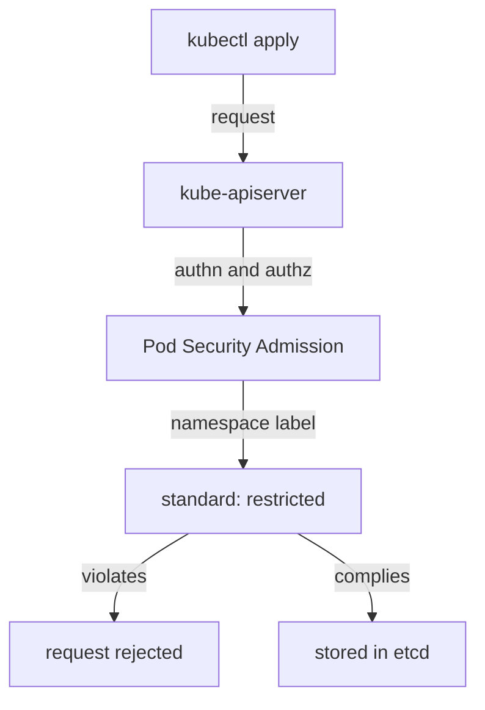

# DevSecOps Guardrails In The Platform

Security that depends on every team remembering a checklist fails on the day a team is in a hurry. DevSecOps moves security checks into the delivery path, so that an unsafe workload is stopped at the moment it is created and the developer learns why. A platform team builds these checks once as guardrails and applies them to every namespace. This part shows how a pod's security settings work, how Pod Security Admission enforces a standard and how the team keeps control of its own workloads inside the boundary.

## Security settings of a pod

A security context is a block of fields in a pod or container that sets privileges and access controls. Its fields decide who the process runs as and what it may do:

- `runAsNonRoot: true` makes the kubelet refuse to start a container that would run as user ID 0 (root).
- `runAsUser` sets the numeric user ID of the process.
- `allowPrivilegeEscalation: false` stops a process from gaining more privileges than its parent, for example through a setuid binary.
- `capabilities.drop: ["ALL"]` removes all Linux capabilities, which are the separate parts of root's powers.
- `seccompProfile.type: RuntimeDefault` applies the default system-call filter of the container runtime.
- `readOnlyRootFilesystem: true` makes the container's root filesystem read-only.

The developer sets these fields in the workload, and the platform checks that they are set. Without a check, a missing field means that the container runs with the broader default privileges.

## Pod Security Admission

Pod Security Admission (PSA) is an admission controller that is built into the API server. An admission controller is a step that runs after authentication and authorization and before the object is stored, and it can reject the request. PSA compares each pod with one of three Pod Security Standards: `privileged` (no restrictions), `baseline` (blocks the known privilege escalations, such as privileged containers and host namespaces) and `restricted` (follows current hardening practice, such as running as non-root and dropping all capabilities).

The platform team selects the standard for a namespace with namespace labels. Each label has a mode: `enforce` rejects violating pods, `audit` writes an audit annotation and `warn` returns a warning to the user. The label key has the form `pod-security.kubernetes.io/<mode>`.

The playground has a namespace `sandbox` with a Deployment `crew`. It runs as it comes from the image, with the default security settings. Check what it sets:

<!-- astrona:playground:renew -->

```sh
kubectl -n sandbox get deployment crew -o jsonpath='{.spec.template.spec.securityContext}{"\n"}{.spec.template.spec.containers[0].securityContext}{"\n"}'
```

Both lines are empty, so the pod has no security context at all. Now ask PSA how it would judge the existing pods, without changing anything. A server-side dry run of the label shows the warnings:

```sh
kubectl label --dry-run=server --overwrite namespace sandbox pod-security.kubernetes.io/enforce=restricted
```

The command prints one warning for the existing pod and lists the violated checks, for example `allowPrivilegeEscalation != false`, `unrestricted capabilities`, `runAsNonRoot != true` and `seccompProfile`. It then prints `namespace/sandbox labeled (server dry run)`. The warnings come from PSA and name each failed field. No object changed.



The diagram shows that PSA is part of the request path, so a violating pod never reaches etcd.

## Enforce the standard

Turn the enforcement on for the namespace:

```sh
kubectl label namespace sandbox pod-security.kubernetes.io/enforce=restricted
```

The command prints `namespace/sandbox labeled`. Existing pods are not evicted: PSA only judges pods when they are created or updated. Trigger a new pod and see what happens:

```sh
kubectl -n sandbox rollout restart deployment/crew
kubectl -n sandbox get events --sort-by=.lastTimestamp
```

The first command prints `deployment.apps/crew restarted`. The Deployment controller creates a new ReplicaSet, and the ReplicaSet controller tries to create a pod. The API server rejects it, and the ReplicaSet controller records the rejection as an event of the form `Error creating: pods "crew-..." is forbidden: violates PodSecurity "restricted:latest"` followed by the violated fields. The old pod keeps running, and the new pods do not appear.

This is a useful feedback signal, but it appears in an event, not in the `kubectl rollout restart` output. A developer must know to look at the events of the ReplicaSet. Platform teams often add `warn` mode next to `enforce` so that the user sees the warning in the response of `kubectl apply`.

## Fix the workload

Make the Deployment comply. Save this as `crew-restricted.yaml`:

```yaml
spec:
  template:
    spec:
      securityContext:
        runAsNonRoot: true
        runAsUser: 1000
        seccompProfile:
          type: RuntimeDefault
      containers:
        - name: crew
          securityContext:
            allowPrivilegeEscalation: false
            capabilities:
              drop: ["ALL"]
```

Apply it and wait for the rollout:

```sh
kubectl -n sandbox patch deployment crew --patch-file crew-restricted.yaml
kubectl -n sandbox rollout status deployment/crew
```

The patch prints `deployment.apps/crew patched`. The new pod passes PSA because it meets every check of the `restricted` standard. The rollout finishes, and the old pod is removed. The team fixed the workload inside its own namespace, and the platform did not need to be involved.

## Resources and access as guardrails

Security guardrails go beyond the pod fields. Resource requests and limits protect other teams from a workload that uses all memory of a node. A request is the amount the scheduler reserves for the container, and a limit is the maximum the container may use. A namespace-level ResourceQuota caps the total, and a LimitRange sets defaults when a container sets none.

Access control limits what the team may do through the API. A Role lists allowed verbs on resources in one namespace, and a RoleBinding grants it to users, groups or service accounts. A team that can create and update Deployments in its own namespace, but cannot read Secrets of other namespaces, can deploy by itself without any risk to the others.

Check what the `bridge-team` group may do now, and again after the platform team binds a role. The built-in ClusterRole `edit` allows working with most namespaced resources, and a RoleBinding makes it valid in one namespace only:

```sh
kubectl -n sandbox create rolebinding bridge-team-edit --clusterrole=edit --group=bridge-team
kubectl auth can-i create deployments -n sandbox --as=jane --as-group=bridge-team
kubectl auth can-i create deployments -n starfleet --as=jane --as-group=bridge-team
```

The first command prints `rolebinding.rbac.authorization.k8s.io/bridge-team-edit created`. The first `can-i` answers `yes`, and the second answers `no`, because the binding is limited to `sandbox`. The platform team wrote the boundary once, and the team works freely inside it.

## Security as shared work

The platform team owns the guardrail: the standard, the namespace labels and the roles. The product team owns the workload that has to comply. When PSA rejects a pod, the product team reads the message and fixes its own manifest. This is the DevSecOps loop: the check runs at creation time, the feedback is specific and the fix is in the hands of the team that owns the workload.

## What you know now

A security context sets who a process runs as and what it may do. Pod Security Admission checks every pod against the `privileged`, `baseline` or `restricted` standard that a namespace label selects, and rejects violations before the object is stored. The rejection appears as an event of the ReplicaSet, which means the team must know where to look. Roles, bindings and quotas complete the boundary inside which a team deploys alone. The remaining question for a platform team is how it measures that these practices help the teams.

## Common pitfalls

> [!WARNING]
> `enforce` does not evict running pods. A namespace can carry the `restricted` label while old violating pods keep running until they are recreated.
> `runAsNonRoot: true` without a numeric `runAsUser` fails when the image declares a user by name, because the kubelet cannot verify a name. Set a numeric user ID.
> A rejected pod does not make the Deployment fail. The Deployment shows fewer ready pods, and the reason is in the events of the ReplicaSet.
