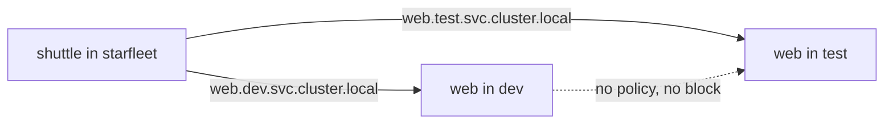

# Environments And The Boundaries That Separate Them

An application environment is a place where software runs with its own configuration, its own data and its own permissions. Development is where people change and try things, test is where a chosen version is checked, and production is where real users depend on the result. The three differ in purpose, and the purpose decides how much access, how much data and how much capacity each one gets. This part shows how a cluster represents environments with namespaces, and what a namespace separates and does not separate.

## Environment names are only names

A cluster has no built-in object called an environment. A team creates one by choosing a mechanism and applying a naming convention: a separate cloud account, a separate cluster, or a namespace inside one cluster. Each mechanism separates different things. A separate cluster separates the API server, the nodes and the network. A namespace separates the names of objects and the scope of permissions and quotas, and nothing more by default.

Because the name does not enforce anything, a platform labels the namespace and then attaches the controls that make the label true. The playground has three namespaces for this module. Look at them with their labels:

<!-- astrona:playground:renew -->

```sh
kubectl get namespaces dev test prod --show-labels
```

Each line shows a namespace with the label `environment=dev`, `environment=test` or `environment=prod`, and also the automatic label `kubernetes.io/metadata.name`. The `environment` label was added by the author of the playground. Kubernetes does not read it, so it changes no behavior. Policies, dashboards and cost reports can select on it.

## What a namespace does separate

A namespace is a scope for names. Two objects of the same kind can have the same name when they are in different namespaces. Create the same Deployment in `dev` and in `test`:

```sh
kubectl -n dev create deployment web --image=ghcr.io/stefanprodan/podinfo:6.15.0 --port=9898
kubectl -n test create deployment web --image=ghcr.io/stefanprodan/podinfo:6.15.0 --port=9898
kubectl get deployments -A --selector=app=web
```

Both create commands print `deployment.apps/web created`. The list shows two rows named `web`, one in each namespace. This is how one definition can be used in every environment without renaming it.

A namespace is also the scope for a Role, a RoleBinding, a ResourceQuota, a LimitRange, a ServiceAccount, a ConfigMap and a Secret. These objects exist inside one namespace and apply to it. That is why the namespace is a practical environment boundary for permissions and capacity.

## What a namespace does not separate

Namespaces do not separate the network. A pod can send a request to a Service in any namespace when it uses the full DNS name `<service>.<namespace>.svc.cluster.local`. Expose `web` in `dev`, wait for it, and call it from the `shuttle` pod that lives in `starfleet`:

```sh
kubectl -n dev expose deployment web --port=9898
kubectl -n dev rollout status deployment/web
kubectl -n starfleet exec deploy/shuttle -- curl -s -o /dev/null -w '%{http_code}\n' http://web.dev.svc.cluster.local:9898/readyz
```

The `expose` command prints `service/web exposed`. The last command prints `200`. A pod in one namespace reached a Service in another one. Nothing in the namespace stopped it, because no NetworkPolicy exists. A NetworkPolicy is a separate object, and it only has an effect when the cluster's network plugin enforces it.



The diagram shows that the names are scoped, and the routes are not. Nodes are shared as well. All namespaces in one cluster run on the same nodes, so one pod that fills a node affects pods in every namespace, unless quotas and limits prevent it.

## Shared kernel, shared control plane

Containers in different namespaces share the node's kernel. A container that escapes its isolation reaches the node, not only its own namespace. The API server, etcd and the cluster-wide objects, such as nodes, namespaces and custom resource definitions, are also shared. An administrator of the cluster has access to every environment in it.

Teams choose a stronger boundary when the risk justifies the cost. Production is often placed in its own cluster or account, while development and test share a cluster and are separated by namespaces. The choice depends on what an incident in one environment can cost another. The answer must name which resources are shared.

## Same artifact, different configuration

The same container image should move through the environments, so that what was tested is what runs. What changes is the configuration around it: endpoints, credentials, log level and capacity. Each namespace keeps its own ConfigMap named `app-config`. Compare the three:

```sh
kubectl -n dev get configmap app-config -o jsonpath='{.data}{"\n"}'
kubectl -n test get configmap app-config -o jsonpath='{.data}{"\n"}'
kubectl -n prod get configmap app-config -o jsonpath='{.data}{"\n"}'
```

Each command prints one JSON object with the keys `DATABASE_HOST`, `ENVIRONMENT` and `LOG_LEVEL`. The keys are the same in all three. The values differ on purpose. That is configuration parity: the contract, meaning the set of keys the application needs, is identical, and the values belong to the environment.

A gap in the contract is a risk. If a key exists in `test` and is missing in `prod`, a test that passes says little about production. A platform can compare the key sets and report a difference before a release.

## A missing dependency is not an application crash

A workload can be valid and still not run because something it depends on is missing: a ConfigMap, a Secret, a volume or a network route. These failures look different from an application that crashes, and a platform should make the difference visible. Save this as `needs-config.yaml`:

```yaml
apiVersion: v1
kind: Pod
metadata:
  name: needs-config
  namespace: dev
spec:
  containers:
    - name: needs-config
      image: curlimages/curl:8.22.0
      command: ["sh", "-c", "sleep 3600"]
      envFrom:
        - configMapRef:
            name: not-there
```

Apply it and read the status:

```sh
kubectl apply -f needs-config.yaml
kubectl -n dev get pod needs-config
kubectl -n dev describe pod needs-config
```

The first command prints `pod/needs-config created`. The pod stays in the status `CreateContainerConfigError`, and the restart count stays at `0`. The events at the end of `describe` say that the ConfigMap `not-there` was not found. No container started, so no application code ran. Compare this with a container that starts and exits, which shows `CrashLoopBackOff` and a growing restart count. The first is a missing dependency, and the second is a failing application.

Create the dependency and the kubelet retries on its own:

```sh
kubectl -n dev create configmap not-there --from-literal=EXAMPLE=value
kubectl -n dev wait --for=condition=Ready pod/needs-config --timeout=120s
```

The first command prints `configmap/not-there created`. The second prints `pod/needs-config condition met` after the kubelet's next retry. Clean up with `kubectl -n dev delete pod needs-config` and `kubectl -n dev delete configmap not-there`.

## What you know now

An environment is a purpose with controls attached, and a name or a label does not enforce anything. A namespace scopes names, permissions, quotas and configuration objects. It does not scope the network, the nodes, the kernel or the control plane. A single artifact moves between environments, and the configuration changes around it while the set of keys stays the same.

## Common pitfalls

> [!WARNING]
> A namespace called `prod` is not a protected production environment. Without a quota, a role, a network policy and a Pod Security label, it behaves like any other namespace.
> A pod can call a Service in another namespace by its full DNS name when no NetworkPolicy blocks it.
> Cleaning up `web` in one namespace does not clean it up in the other. Delete each one, or delete the namespace.
