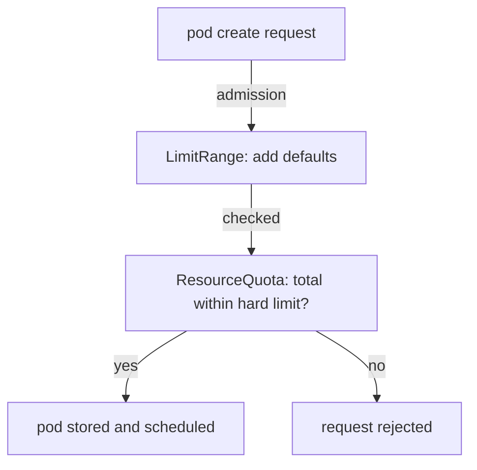

# Quotas, Limits And Capacity Isolation

Several teams and several environments can share the same nodes. If one workload uses all the memory of a node, the others slow down or are killed. Kubernetes limits this with requests and limits on containers, with a ResourceQuota that caps a namespace, and with a LimitRange that supplies defaults and bounds. This part builds these controls in the `test` namespace and shows the exact signals that a team sees when it hits them.

## Requests and limits

A container can declare two numbers for each resource. The request is the amount the scheduler reserves on a node for the container. A pod is only placed on a node that still has the requested amount free. The limit is the most the container may use. For memory, a container that goes over its limit is killed by the kernel and reported as `OOMKilled`. For CPU, a container over its limit is slowed down and is not killed.

A request is a scheduling promise, and it is not a guarantee that the node has unlimited capacity. A pod without any request is placed as if it needed nothing, which makes the node's load hard to predict. The quality of service class summarizes this. A pod that has no requests and limits is `BestEffort` and is the first to be evicted under node pressure. A pod where requests are lower than limits is `Burstable`. A pod where requests equal limits for every resource is `Guaranteed`.

## A ResourceQuota caps a namespace

A ResourceQuota limits the total amount of resources and the number of objects in one namespace. The API server checks it when an object is created or updated, and rejects the request when the total would go over the cap. Save this as `test-quota.yaml`:

```yaml
apiVersion: v1
kind: ResourceQuota
metadata:
  name: test-quota
  namespace: test
spec:
  hard:
    pods: "3"
    requests.memory: 128Mi
    limits.memory: 256Mi
```

Apply it:

<!-- astrona:playground:renew -->

```sh
kubectl apply -f test-quota.yaml
```

Then check:

```sh
kubectl -n test describe resourcequota test-quota
```

The command prints `resourcequota/test-quota created` first. The `describe` output lists each resource with `Used` and `Hard` columns. The used values are `0`, `0` and `0`, and the hard values are `3`, `128Mi` and `256Mi`.

## A quota changes what is accepted

When a quota covers `requests.memory` or `limits.memory`, every new pod must state those values. A pod without them is rejected. Create a Deployment with no resources, and read why no pod appears:

```sh
kubectl -n test create deployment crew --image=ghcr.io/stefanprodan/podinfo:6.15.0 --replicas=2
kubectl -n test get deployment crew
kubectl -n test get events --field-selector reason=FailedCreate
```

The create command prints `deployment.apps/crew created`. The Deployment stays at `0/2` ready. The events list `FailedCreate` entries that begin with `Error creating: pods` and say `failed quota: test-quota` followed by the names of the missing fields. The Deployment is valid, and the ReplicaSet controller is the one whose pod creation is refused. The feedback is in the events and not in the output of the command.

## A LimitRange supplies defaults

A LimitRange sets defaults and bounds for containers in a namespace. A container without requests or limits receives the default values when it is created, and a value outside the minimum or maximum is rejected. Save this as `test-defaults.yaml`:

```yaml
apiVersion: v1
kind: LimitRange
metadata:
  name: test-defaults
  namespace: test
spec:
  limits:
    - type: Container
      defaultRequest:
        memory: 16Mi
      default:
        memory: 64Mi
```

Apply it and let the ReplicaSet retry:

```sh
kubectl apply -f test-defaults.yaml
kubectl -n test rollout status deployment/crew --timeout=120s
```

The first command prints `limitrange/test-defaults created`. A LimitRange only applies to pods that are created after it exists. The ReplicaSet controller retries with backoff, so the pods appear after a short delay, and the rollout reaches `2 of 2` replicas. If the wait is too long, run `kubectl -n test rollout restart deployment/crew` to create a new ReplicaSet at once.

Check what was injected into the pod. The Deployment never mentioned resources:

```sh
kubectl -n test get pods -l app=crew -o jsonpath='{.items[0].spec.containers[0].resources}{"\n"}'
kubectl -n test get pods -l app=crew -o jsonpath='{.items[0].status.qosClass}{"\n"}'
```

The first command prints a JSON object with `limits.memory` `64Mi` and `requests.memory` `16Mi`. The second prints `Burstable`, because the request is below the limit. The defaults came from the admission step, and they are stored in the pod, not in the Deployment.

## The cap is enforced on the total

Two replicas use `32Mi` of requests and `128Mi` of limits. The quota allows three pods. Scale up and look at the result:

```sh
kubectl -n test scale deployment/crew --replicas=5
kubectl -n test get pods -l app=crew
kubectl -n test describe resourcequota test-quota
```

The scale command prints `deployment.apps/crew scaled`. The list shows three pods and not five. The `describe` output shows `pods` at `3` of `3` and `limits.memory` at `192Mi` of `256Mi`. The events of the ReplicaSet say `exceeded quota: test-quota` with the requested, used and limited values. The quota is the stop, and the Deployment keeps asking for five.



The diagram shows the order: defaults are added first, and the quota is checked with the filled-in values. That is why a LimitRange makes a quota usable for teams that do not write resources.

## What you know now

Requests reserve capacity for scheduling, and limits cap what a container may use. A ResourceQuota caps the total of a namespace and rejects requests that would exceed it. A LimitRange fills in defaults and bounds so a quota can accept pods that declare nothing. The signals of these controls are events on the ReplicaSet, so a team must know where to look.

## Common pitfalls

> [!WARNING]
> A quota on `requests.memory` rejects every pod that does not declare a request, unless a LimitRange supplies a default.
> A LimitRange does not change pods that already exist. Recreate them to receive the defaults.
> A quota can keep a Deployment at fewer pods than it asks for without any failed command. Read the events and the quota usage.
