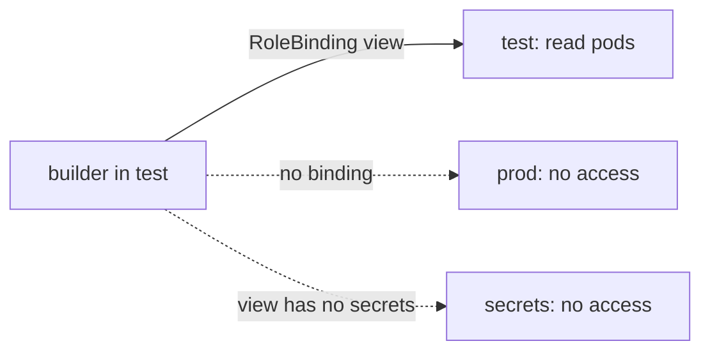

# Identity, Data And Environment Lifecycle

An environment is more than the pods in it. It also has identities that may act in it, data and credentials that belong to it, and a life that starts and ends. Most serious environment mistakes come from here: a test workload that holds a production credential, a developer who can change production, or an environment that is removed and leaves its data behind. This part builds these boundaries in the playground namespaces `dev`, `test` and `prod`.

## Identity per environment

In Kubernetes, a workload acts as a ServiceAccount, and a person or a group is named by the authentication method of the cluster. Authorization is checked by RBAC. A Role lists verbs on resources in one namespace, and a RoleBinding grants a Role, or a ClusterRole used inside one namespace, to subjects. A subject has no rights in a namespace that has no binding for it.

Create a service account for a build job in `test`, and bind the built-in read-only ClusterRole `view` in that namespace only:

<!-- astrona:playground:renew -->

```sh
kubectl -n test create serviceaccount builder
kubectl -n test create rolebinding builder-view --clusterrole=view --serviceaccount=test:builder
```

The commands print `serviceaccount/builder created` and `rolebinding.rbac.authorization.k8s.io/builder-view created`. A ClusterRole is a reusable list of rules, and the RoleBinding makes it valid in `test` only. Ask the API server what the account can do, with `--as` to act as another identity:

```sh
kubectl auth can-i list pods -n test --as=system:serviceaccount:test:builder
kubectl auth can-i list pods -n prod --as=system:serviceaccount:test:builder
kubectl auth can-i list secrets -n test --as=system:serviceaccount:test:builder
```

The answers are `yes`, `no` and `no`. The first is allowed by the binding. The second has no binding in `prod`. The third is refused because `view` does not include Secrets, even in the namespace where it is bound. A boundary between environments is a missing binding, and that makes it necessary to review the bindings, not the names of the namespaces.



## Data and credentials belong to one environment

Production data can contain personal or confidential records. A test environment should hold only the data its checks need, and a test workload should never hold a production credential. A short-lived or temporary environment is no safer if it uses a production token, because the token has the same power as before.

Kubernetes stores credentials in Secrets, which live in a namespace. Create a different value in each environment:

```sh
kubectl -n test create secret generic db-credentials --from-literal=password=test-only-value
kubectl -n prod create secret generic db-credentials --from-literal=password=prod-only-value
kubectl -n test get secret db-credentials -o jsonpath='{.data.password}{"\n"}'
```

The first two commands print `secret/db-credentials created`. The last prints the value as base64 text. Base64 is an encoding and not encryption: anyone who may read the Secret can decode it with `base64 -d`. Access to a Secret is controlled by RBAC, and the data may be encrypted at rest by the API server when the cluster is configured for it. A copy of the production Secret into `test` removes the boundary even if the namespaces stay separate.

Check that the two values are different, without printing them:

```sh
[ "$(kubectl -n test get secret db-credentials -o jsonpath='{.data.password}')" != "$(kubectl -n prod get secret db-credentials -o jsonpath='{.data.password}')" ] && echo different
```

The command prints `different`. The name of the Secret is the same in both environments, which keeps the application unchanged, and the value belongs to each environment.

## The same artifact, configured per environment

The application reads its environment settings from the ConfigMap of its namespace. Run the same image in `dev` and in `test`, and give each one the settings of its own namespace:

```sh
kubectl -n dev create deployment web --image=ghcr.io/stefanprodan/podinfo:6.15.0
kubectl -n test create deployment web --image=ghcr.io/stefanprodan/podinfo:6.15.0
kubectl -n dev set env deployment/web --from=configmap/app-config
kubectl -n test set env deployment/web --from=configmap/app-config
kubectl -n dev rollout status deployment/web --timeout=120s
kubectl -n test rollout status deployment/web --timeout=120s
```

The create commands print `deployment.apps/web created`, and the `set env` commands print `deployment.apps/web env updated`. Each `set env` changes the pod template, so the rollout waits for the new pod. Read the variables in each pod:

```sh
kubectl -n dev exec deploy/web -- printenv ENVIRONMENT DATABASE_HOST
kubectl -n test exec deploy/web -- printenv ENVIRONMENT DATABASE_HOST
```

The first command prints `dev` and the database host of `dev`, and the second prints `test` and the host of `test`. The image tag is identical, and the behavior differs only through configuration. This is what parity means in practice: an artifact verified in `test` is the artifact that goes to production, and the differences are known and listed.

## Lifecycle: creation, change and removal

An environment has a life. It is created with its quota, its roles and its labels. It changes as credentials rotate and capacity grows. It ends when the work is done. A temporary environment for a pull request needs the same identity and limits as a long-lived one, plus a rule for when it is removed.

Deleting a namespace deletes every namespaced object in it. Try it with a short-lived environment:

```sh
kubectl create namespace preview-42
kubectl -n preview-42 create configmap app-config --from-literal=ENVIRONMENT=preview
kubectl -n preview-42 create deployment web --image=ghcr.io/stefanprodan/podinfo:6.15.0
kubectl delete namespace preview-42
kubectl get namespace preview-42
```

The delete command waits until the namespace is gone and prints `namespace "preview-42" deleted`. The last command prints `Error from server (NotFound)`. The Deployment, its pods, the ConfigMap and the service accounts were removed with it.

Removal is only complete for objects inside the namespace. Data kept outside it, such as a database or a bucket of the provider, remains unless something deletes it. A PersistentVolume with the reclaim policy `Retain` also stays after its claim is gone. The cleanup rule must say what is ephemeral and what must be kept or transferred. An unexplained leftover resource is neither a retained record nor a finished cleanup.

## What you know now

Identity is a boundary only when bindings are limited to the environment they belong to, and a missing binding is the boundary. Secrets and data belong to one environment, and encoding is not protection. The same image moves between environments with configuration that has the same keys and different values. Deleting a namespace removes what is inside it and nothing outside, so the lifecycle needs a stated rule for everything else.

## Common pitfalls

> [!WARNING]
> Base64 in a Secret is not encryption. Treat read access to a Secret as access to its value.
> A copy of a production credential in a test namespace removes the boundary even if the namespaces are separate.
> Deleting a namespace does not remove external databases, buckets or retained volumes.
