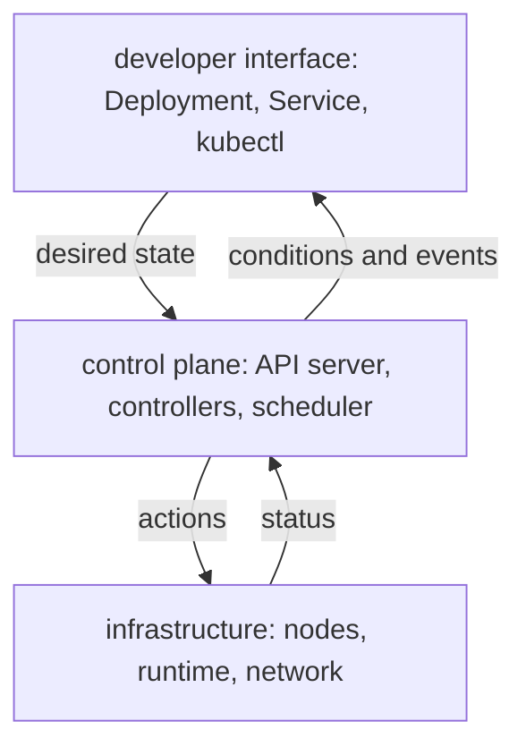

# Capability Layers And Supported Interfaces

A platform offers capabilities, such as running a workload, reaching it over the network or storing data. A developer asks for a capability through an interface, and other components do the work behind it. Keeping these three things apart makes the platform easy to use and safe to change: the capability is what the user needs, the interface is how the user asks, and the implementation is what actually happens. This part uses Kubernetes itself as the example, because it is built in exactly these layers.

## Three layers

A useful picture of a platform has three layers:

- The developer interface is the set of objects and commands a user works with, for example a Deployment, a Service and `kubectl`.
- The control plane is the set of components that read those requests and make them true. They store the desired state, decide where work runs and keep reconciling.
- The infrastructure is what runs the work: nodes, the container runtime, the network and the storage.

A request travels from the top to the bottom, and status travels back up. The user does not need to know which node runs a pod or how the network delivers a packet. The platform team does need to know, because it owns the layers below the interface.



## See the interface

Every kind of object that the API server serves is part of the interface. List the kinds in the `apps` group and read the documentation of one field, which the API server itself provides:

<!-- astrona:playground:renew -->

```sh
kubectl api-resources --api-group=apps
kubectl explain deployment.spec.replicas
```

The first command prints a table with the names `daemonsets`, `deployments`, `replicasets` and `statefulsets`, their short names and the value `true` in the `NAMESPACED` column. The second prints the field name, its type `integer` and a description. The interface describes itself, so a user can discover what to ask for without reading the platform's source code.

## See the control plane

In the kind cluster the control plane components run as pods in the namespace `kube-system`. List them:

```sh
kubectl -n kube-system get pods
```

The list contains a pod for `etcd`, `kube-apiserver`, `kube-controller-manager` and `kube-scheduler`, with the node name appended, and pods for `coredns` and `kube-proxy`. The API server is the only component that talks to etcd, and every other component talks to the API server. The scheduler picks a node for a pod that has none, and the controller manager runs the controllers, such as the Deployment controller. Ask the API server whether it is ready, with the detail of each check:

```sh
kubectl get --raw '/readyz?verbose' | tail -n 5
```

The output has one line per check, in the form `[+]` followed by a name for a passing check, and the last line is `readyz check passed`. The control plane reports its own health through the same API that users call.

## See the infrastructure

The infrastructure layer is the node and what runs on it. Look at it and at the place where one pod runs:

```sh
kubectl get nodes -o wide
kubectl -n starfleet get pods -l app=scout -o wide
```

The first command prints the single node with its status `Ready`, the Kubernetes version `v1.35.8` and the container runtime. The second prints the `scout` pod with its IP address and the node it is on. A user wrote a Deployment and never chose the node. The scheduler chose it, and the kubelet on that node started the container.

## The interface stays when the implementation changes

A supported interface is a promise that the same request keeps its meaning when the implementation changes. A Service is an example. The user asks for a stable name and a port for a set of pods. The implementation keeps the list of pod addresses in EndpointSlices and programs the node's network rules with `kube-proxy`, and a different network plugin can replace that part. Look at the part below the interface:

```sh
kubectl -n starfleet get service scout
kubectl -n starfleet get endpointslices -l kubernetes.io/service-name=scout
```

The first command prints the Service with a cluster IP and port `80`. The second prints an EndpointSlice that lists the address of the `scout` pod. Scale `scout` to two replicas and read the slice again:

```sh
kubectl -n starfleet scale deployment/scout --replicas=2
kubectl -n starfleet rollout status deployment/scout
kubectl -n starfleet get endpointslices -l kubernetes.io/service-name=scout -o jsonpath='{.items[0].endpoints[*].addresses}{"\n"}'
```

The scale command prints `deployment.apps/scout scaled`. The last command prints two addresses. The user did not change the Service. A controller updated the EndpointSlice, and the Service kept its name and port. Return to one replica with `kubectl -n starfleet scale deployment/scout --replicas=1`.

## Composability and ownership

Each layer should be replaceable on its own, and each should have one owner. The user owns the request. The platform team owns the interface, and the controllers and infrastructure behind it. When ownership is not clear, a failure falls between teams: the user blames the platform, and the platform blames the request. A good interface reports the cause in its status, so the person who can act on it sees it.

A platform is also a set of capabilities that combine. A workload capability, a network capability and an identity capability work together because each has a defined interface. A platform that exposes every internal detail to users forces them to combine the details by themselves, and a change of any detail then breaks them.

## What you know now

A platform separates the capability, the interface and the implementation into layers. In Kubernetes, the objects are the interface, the API server and controllers are the control plane, and the nodes and runtime are the infrastructure. The same request keeps its meaning when the implementation below it changes, which is what makes an interface supported. Status flows back up through conditions and events, so the owner of each layer can be found.

## Common pitfalls

> [!WARNING]
> Pods in `kube-system` are the cluster's own components. Do not delete or edit them while exploring.
> An interface that exposes implementation details cannot change its implementation without breaking its users.
> A healthy object at the top does not prove that every layer below is healthy. Read status and events at each layer.
