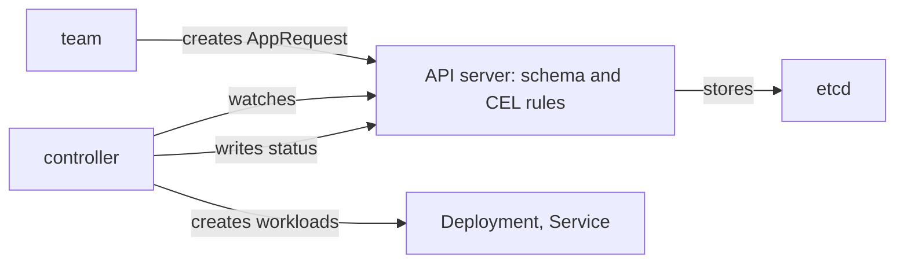

# A Custom Resource As A Platform API

Kubernetes lets a platform team add its own kinds of objects to the API server. A CustomResourceDefinition (CRD) describes a new kind, and from then on users create objects of that kind with `kubectl` like any other object. This is how many platforms offer a capability in the platform's own words, such as "request an application", without exposing the Deployments, Services and policies behind it. This part builds such an API in the playground and shows what the CRD does by itself and what it leaves to a controller.

## A CRD defines the interface

A CRD names the group, the kind and the scope of the new type, and contains a schema that the API server uses to validate every object. The schema is the contract with the user. Save this as `apprequest-crd.yaml`:

```yaml
apiVersion: apiextensions.k8s.io/v1
kind: CustomResourceDefinition
metadata:
  name: apprequests.platform.starfleet.io
spec:
  group: platform.starfleet.io
  scope: Namespaced
  names:
    plural: apprequests
    singular: apprequest
    kind: AppRequest
    shortNames:
      - apr
  versions:
    - name: v1
      served: true
      storage: true
      subresources:
        status: {}
      additionalPrinterColumns:
        - name: Tier
          type: string
          jsonPath: .spec.tier
        - name: Phase
          type: string
          jsonPath: .status.phase
      schema:
        openAPIV3Schema:
          type: object
          properties:
            spec:
              type: object
              required: ["name", "tier"]
              x-kubernetes-validations:
                - rule: "self.tier != 'large' || has(self.contact)"
                  message: "a large request needs a contact"
              properties:
                name:
                  type: string
                tier:
                  type: string
                  enum: ["small", "medium", "large"]
                replicas:
                  type: integer
                  minimum: 1
                  maximum: 5
                contact:
                  type: string
            status:
              type: object
              properties:
                phase:
                  type: string
```

The name of a CRD must be the plural name and the group joined by a dot. The `status` subresource separates the user's part from the platform's part: users write `spec`, and controllers write `status` through a different endpoint with its own permission. The `x-kubernetes-validations` entry is a rule in the Common Expression Language (CEL), where `self` is the object at that level of the schema.

Apply it and wait until the API server serves the new kind:

<!-- astrona:playground:renew -->

```sh
kubectl apply -f apprequest-crd.yaml
kubectl wait --for=condition=Established crd/apprequests.platform.starfleet.io --timeout=60s
```

The first command prints `customresourcedefinition.apiextensions.k8s.io/apprequests.platform.starfleet.io created`. The second prints `customresourcedefinition.apiextensions.k8s.io/apprequests.platform.starfleet.io condition met`. Then check:

```sh
kubectl api-resources --api-group=platform.starfleet.io
kubectl explain apprequest.spec.tier
```

The first command lists `apprequests` with the short name `apr` and the kind `AppRequest`. The second prints the field documentation, including the allowed values. The new kind is now part of the interface, and the schema documents itself.

## Valid and invalid requests

Save this as `scout-request.yaml`:

```yaml
apiVersion: platform.starfleet.io/v1
kind: AppRequest
metadata:
  name: scout-request
  namespace: starfleet
spec:
  name: scout
  tier: small
  replicas: 2
```

Apply it and read it:

```sh
kubectl apply -f scout-request.yaml
kubectl -n starfleet get apr
```

The first command prints `apprequest.platform.starfleet.io/scout-request created`. The list has the columns `NAME`, `TIER`, `PHASE` and `AGE`. The phase column is empty, because nothing has written a status. Now send requests that break the contract. A server-side dry run runs the validation and stores nothing:

```sh
kubectl -n starfleet create --dry-run=server -f - <<'YAML'
apiVersion: platform.starfleet.io/v1
kind: AppRequest
metadata:
  name: bad-tier
spec:
  name: scout
  tier: huge
  replicas: 9
YAML
```

The command fails with `The AppRequest "bad-tier" is invalid` and lists each problem: the value `huge` is not one of the supported values, and `9` is above the maximum. The API server rejected the request before any controller saw it. The rule with CEL is checked the same way. Send a `large` request without a contact:

```sh
kubectl -n starfleet create --dry-run=server -f - <<'YAML'
apiVersion: platform.starfleet.io/v1
kind: AppRequest
metadata:
  name: no-contact
spec:
  name: scout
  tier: large
YAML
```

The command fails and prints the message `a large request needs a contact`. The schema gave the user an immediate, specific answer.

## A CRD is an API, not an implementation

Creating an `AppRequest` did not create a Deployment, a Service or any pod. A CRD only stores objects and validates them. The behavior comes from a controller that watches the objects and acts on them. No controller exists in this playground, so the request just sits in the API server. Check that nothing happened:

```sh
kubectl -n starfleet get deployments
```

The list contains only `scout`, `probe` and `shuttle`. This is the key point of the part: the capability, the interface and the implementation are three separate things. The CRD is the interface. A controller, written by the platform team and run in the cluster, is the implementation.

Act as that controller once, and write a status through the status endpoint:

```sh
kubectl -n starfleet patch apprequest scout-request --subresource=status --type=merge -p '{"status":{"phase":"Accepted"}}'
kubectl -n starfleet get apr
```

The first command prints `apprequest.platform.starfleet.io/scout-request patched`. The list now shows `Accepted` in the phase column. A real controller would do the same after it finished its work, so that the user reads the outcome on the object that was requested.



## What you know now

A CRD adds a kind to the API with a schema that is validated by the API server, so a platform can offer a capability in its own vocabulary. Enums, number bounds and CEL rules reject bad requests with specific messages before any controller runs. The `status` subresource keeps the user's declaration and the platform's report apart. A CRD stores and validates objects only, so without a controller nothing happens, and the platform team owns that controller.

## Common pitfalls

> [!WARNING]
> A custom resource without a controller does nothing. A user who sees `created` may wrongly assume the capability was delivered, so show the phase in the status.
> Removing a CRD deletes every object of that kind. Treat it as a destructive change.
> A schema that is too loose accepts bad requests, and a schema that is too strict blocks users. Change a published schema in compatible steps.
