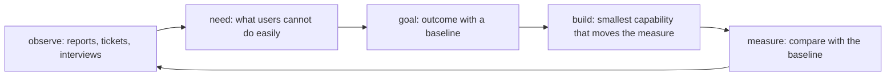

# User Needs And Platform Goals

Platform engineering starts with the people who use the platform. A platform team that begins with tools builds what it finds interesting, and a platform team that begins with the difficulties of its users builds what removes work. This part shows how to turn an observed difficulty into a goal with a baseline and a measure, using the example workloads of the playground as the evidence.

## Needs, goals and outputs

A need is something a user has to achieve and cannot do easily today, for example "get a service running with a health check without reading three documents". A goal states the improvement the platform intends to deliver for that need. An output is something the platform team produces, such as a template or a pipeline. Outputs are easy to count and say little about value. A goal names the user, the task and the change:

- Weak: "We installed a deployment tool."
- Better: "New services reach a running state with a readiness probe and resource limits, without a ticket."

The second statement can be checked. It also names a baseline question, which is how often services reach production without those settings today. Without a baseline, a team cannot say whether the platform improved anything.

## Learn the needs from evidence

Interviews, support requests and incident reviews show what users struggle with. The cluster itself is also a source of evidence, because the objects that teams created show what they actually set and what they leave out. In the playground, ask which Deployments have a readiness probe, resource limits and an owner label. Run this report:

<!-- astrona:playground:renew -->

```sh
kubectl get deployments -A -o json | jq -r '.items[] | select(.metadata.namespace == "starfleet" or .metadata.namespace == "outpost") | [.metadata.namespace, .metadata.name, (.spec.template.spec.containers[0].readinessProbe != null), (.spec.template.spec.containers[0].resources.limits != null), (.spec.template.metadata.labels.owner // "none")] | @tsv'
```

The command prints one tab-separated row for each of the four Deployments: the namespace, the name, whether a readiness probe is set, whether limits are set and the owner label. `scout` shows `true` for the probe, and the other three show `false`. All four show `true` for limits and `none` for the owner. This is a baseline: three of four workloads have no readiness probe, and none names an owner.

Count it as a number that can be compared later:

```sh
kubectl get deployments -A -o json | jq '[.items[] | select(.metadata.namespace == "starfleet" or .metadata.namespace == "outpost") | select(.spec.template.spec.containers[0].readinessProbe == null)] | length'
```

The command prints `3`. The platform team now has a starting value and a goal: after the golden path exists, the number of new workloads without a probe should be zero. The evidence is a symptom and not a diagnosis. A missing probe can mean that teams do not know about probes, that they do not know what endpoint to use, or that they were never asked. A short conversation with the teams decides which, and that decides what to build.

## Choose what to build

A platform team has more requests than time, so it needs a way to choose. Three questions help:

1. How many users have the need, and how often?
2. How much effort or risk does the need cause each time?
3. Can the platform remove the need, or can it only document it?

A need that affects many teams every week and takes hours each time ranks above a rare need that affects one team. A need that is rare and risky, such as a data-loss incident, can still rank high. The choice and its reason should be visible to the users, so that they can correct a wrong assumption.

## Measure outcomes, not activity

Useful measures follow the user's task:

- Time from request to a working environment, or from a merged change to a running workload.
- Share of workloads that meet a defined baseline, such as a probe, limits and an owner.
- Number of tickets that a capability replaced.
- Adoption: how many teams use the capability by choice.

Measures that count the platform's activity, such as the number of templates published, do not show whether anyone is better off. A measure also has a limit. A high adoption number can mean that the path is good, or that a mandate forced the teams to use it. Pair a number with feedback from the users.

## Separate users by role

Not every user of a platform has the same need. An application developer wants to ship a service. An operator of a shared service wants predictable capacity. A security reviewer wants evidence that a baseline holds. One capability can serve one role well and get in the way of another. When the platform team writes a goal, it names the role, so that the measure matches the person. A goal for developers is measured in time to a running workload. A goal for reviewers is measured in the share of workloads that meet the baseline.

## Keep the first goal small

A goal that covers every need cannot be measured and cannot be finished. Pick one need, one group of users and one measure, and deliver the smallest capability that moves it. After the measure changes, the next goal is easier to choose, because there is new evidence. A small first step also limits the damage when the assumption was wrong.

## Goals need an owner and a boundary

A goal should say which part of the user's work the platform takes over and which part stays with the team. If the platform promises to provide health checks, it must say who chooses the endpoint. If it does not, the team sees the platform as an obstacle, and the platform team sees the team as careless. A written boundary prevents both. The playground has `scout` with a probe at `/readyz` and `probe` without one. Which of the two is right depends on what the application offers, and that knowledge is with the team.



The diagram shows a loop. The measure after a release is new evidence for the next round.

## What you know now

A platform goal names a user, a task and an expected change, and it needs a baseline to show improvement. The cluster provides evidence of what teams set and omit, and a count taken before the work gives the starting value. Prioritization weighs how many users, how often and how costly. Outcome measures follow the user's task, and activity measures do not show value. A written boundary tells the team what the platform provides and what the team still decides.

## Common pitfalls

> [!WARNING]
> A count of what is missing is a symptom. Ask the teams why before building something.
> Counting outputs, such as templates or tools, does not show user value.
> A goal without a baseline cannot be shown to have improved.
