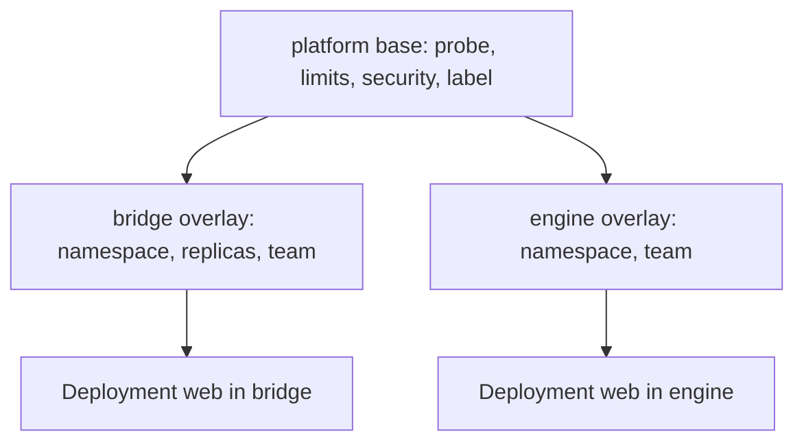

# Golden Paths With A Kustomize Base

A golden path is a supported, opinionated way to complete a common task. For deploying a service it can be a template that already contains the settings that the platform recommends: a readiness probe, resource limits, a restricted security context and an owner label. A team takes the path, changes only what is specific to its service, and gets a workload that meets the platform's baseline. This part builds such a path with Kustomize, where the platform team publishes a base and each team consumes it with a small overlay.

## What the path contains

The base should carry what is the same for every service, and leave open what the team decides. In this example, the platform sets:

- the label `platform.starfleet.io/path: golden`, so that the platform can find workloads on the path,
- a readiness probe on the named port `http`,
- memory and CPU requests and a memory limit,
- the settings of the `restricted` Pod Security Standard,
- a Service in front of the pods.

The team decides the namespace, the number of replicas and its own labels. The line between the two is the contract of the path.

## Write the base

Create a directory for the base and save this as `golden/base/deployment.yaml`:

```yaml
apiVersion: apps/v1
kind: Deployment
metadata:
  name: web
  labels:
    app: web
    platform.starfleet.io/path: golden
spec:
  replicas: 1
  selector:
    matchLabels:
      app: web
  template:
    metadata:
      labels:
        app: web
        platform.starfleet.io/path: golden
    spec:
      securityContext:
        runAsNonRoot: true
        runAsUser: 1000
        seccompProfile:
          type: RuntimeDefault
      containers:
        - name: web
          image: ghcr.io/stefanprodan/podinfo:6.15.0
          ports:
            - name: http
              containerPort: 9898
          readinessProbe:
            httpGet:
              path: /readyz
              port: http
          resources:
            requests:
              cpu: 10m
              memory: 32Mi
            limits:
              memory: 64Mi
          securityContext:
            allowPrivilegeEscalation: false
            capabilities:
              drop: ["ALL"]
```

Save this as `golden/base/service.yaml`:

```yaml
apiVersion: v1
kind: Service
metadata:
  name: web
spec:
  selector:
    app: web
  ports:
    - name: http
      port: 80
      targetPort: http
```

Save this as `golden/base/kustomization.yaml`:

```yaml
apiVersion: kustomize.config.k8s.io/v1beta1
kind: Kustomization
resources:
  - deployment.yaml
  - service.yaml
```

The base has no namespace and no replica count that a team must keep. It states a default of one.

## A team consumes the path

A team writes an overlay that points at the base and states what is its own. Save this as `golden/overlays/bridge/kustomization.yaml`:

```yaml
apiVersion: kustomize.config.k8s.io/v1beta1
kind: Kustomization
namespace: bridge
resources:
  - ../../base
replicas:
  - name: web
    count: 2
labels:
  - pairs:
      team: bridge
    includeTemplates: true
```

The overlay is five lines of choices. Render it and read the result without applying anything:

<!-- astrona:playground:renew -->

```sh
kubectl kustomize golden/overlays/bridge
```

The command prints two YAML documents, a Service and a Deployment, both with `namespace: bridge`. The Deployment has `replicas: 2`, the label `team: bridge` on the object and in the pod template, and every setting of the base. The team did not have to write the probe, the limits or the security context.

## Apply it into a namespace with a guardrail

The platform enforces the baseline where the teams deploy. Create the namespace of the team with the `restricted` standard enforced, and apply the overlay:

```sh
kubectl create namespace bridge
kubectl label namespace bridge pod-security.kubernetes.io/enforce=restricted
kubectl apply -k golden/overlays/bridge
kubectl -n bridge rollout status deployment/web --timeout=120s
```

The commands print `namespace/bridge created`, `namespace/bridge labeled`, and one `created` line each for the Service and the Deployment, then `deployment "web" successfully rolled out`. The pods were accepted because the path already meets the standard. A team that writes its own manifest from scratch must find each setting by itself, and gets rejected by the namespace label until it does.

## A second team, the same path

A second team takes the same base with different choices. Save this as `golden/overlays/engine/kustomization.yaml`:

```yaml
apiVersion: kustomize.config.k8s.io/v1beta1
kind: Kustomization
namespace: engine
resources:
  - ../../base
labels:
  - pairs:
      team: engine
    includeTemplates: true
```

Apply it and compare the two teams' workloads:

```sh
kubectl create namespace engine
kubectl label namespace engine pod-security.kubernetes.io/enforce=restricted
kubectl apply -k golden/overlays/engine
kubectl get deployments -A -l platform.starfleet.io/path=golden -L team
```

The list has two rows named `web`, one in `bridge` with `2/2` ready replicas and one in `engine` with `1/1`, and the `TEAM` column shows the team of each. Both are found with one label selector, which is why the path labels its workloads.



## Updating the path

When the platform team improves the base, for example by raising the memory limit, each team gets the change by applying its overlay again. The overlays stay small, so the platform can change the defaults without editing each team's files. This is also the risk. A change in the base reaches every team on its next apply, so the platform team must version the base and announce breaking changes. A team that pins a version of the base controls when it moves.

## What you know now

A golden path packages the recommended settings so that the team only states what is specific to its service. A Kustomize base holds the shared part, and an overlay holds the choices of a team. A label on the path's workloads lets the platform find them. A namespace with an enforced standard confirms that the path meets the baseline. Improvements to the base reach teams when they apply again, so the base needs versions and notice of breaking changes.

## Common pitfalls

> [!WARNING]
> A base that sets the namespace forces every team into it. Leave the namespace to the overlay.
> A base that changes without notice breaks teams on the next apply. Version it.
> A path that cannot be adjusted for a real requirement pushes teams to leave it. Say what an overlay may change.
