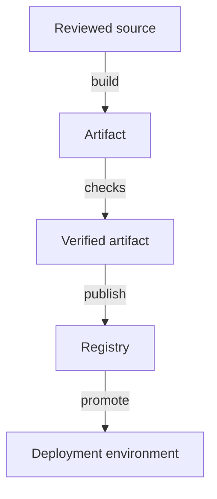

# Source Changes And Build Evidence

A developer changes the `scout` application. Source code is the human-maintained input to a build; an artifact is a packaged output ready for another stage, such as a container image. A delivery pipeline automates the steps that transform a reviewed source revision into a tested and deployable artifact.

Continuous integration (CI) combines changes frequently and runs automated checks against them. Those checks can include compilation, unit tests, integration tests and static analysis. A passing build provides evidence for the checks actually performed, not proof that every production behavior is correct.

Build identity matters. Record the source revision, dependency versions and resulting artifact identity. Rebuilding the same source later can produce different output if dependencies, base images or tools changed. Reproducibility needs control of those inputs rather than only a stable source file.



A pipeline links reviewed inputs to an identifiable artifact and the environment where it is promoted.

## A pipeline stage is a unit of work with an outcome

A CI system runs each stage as an isolated unit of work with an input, a command and an exit status. A cluster has the same shape in a Job: it runs a pod to completion and records whether it succeeded or failed. This part uses Jobs to stand in for pipeline stages, so that the evidence a stage produces can be read from the cluster. The source revision is held in a ConfigMap, which is the input of the stage.

<!-- astrona:playground:renew -->

Create a namespace for the pipeline and save the source revision in it:

```sh
kubectl create namespace ci --dry-run=client -o yaml | kubectl apply -f -
kubectl -n ci create configmap source --from-literal=revision=r1 --from-literal=greeting="hello from scout"
```

The commands print `namespace/ci created` and `configmap/source created`. Save this as `unit-checks.yaml`:

```yaml
apiVersion: batch/v1
kind: Job
metadata:
  name: unit-checks
  namespace: ci
  labels:
    ci.starfleet.io/revision: r1
spec:
  backoffLimit: 0
  template:
    metadata:
      labels:
        ci.starfleet.io/revision: r1
    spec:
      restartPolicy: Never
      containers:
        - name: check
          image: curlimages/curl:8.22.0
          command: ["sh", "-c"]
          args:
            - test "$(cat /source/revision)" = "r1" && test -n "$(cat /source/greeting)"
          volumeMounts:
            - name: source
              mountPath: /source
      volumes:
        - name: source
          configMap:
            name: source
```

Apply it and wait for the stage to finish:

```sh
kubectl apply -f unit-checks.yaml
kubectl -n ci wait --for=condition=complete job/unit-checks --timeout=120s
```

The first command prints `job.batch/unit-checks created`, and the second prints `job.batch/unit-checks condition met`. The check mounted the source as files, compared the revision and the greeting, and exited with status zero. The Job records `succeeded: 1`. The `backoffLimit: 0` setting means that a failure is not retried, so a failing check is reported at once.

## A failed stage must stop the pipeline

A check that cannot fail gives no evidence. Create a stage that looks for a file the source does not contain, and wait for it to fail:

```sh
kubectl apply -f - <<'YAML'
apiVersion: batch/v1
kind: Job
metadata:
  name: bad-check
  namespace: ci
spec:
  backoffLimit: 0
  template:
    spec:
      restartPolicy: Never
      containers:
        - name: check
          image: curlimages/curl:8.22.0
          command: ["sh", "-c", "test -f /source/missing"]
YAML
kubectl -n ci wait --for=condition=failed job/bad-check --timeout=120s
```

The wait prints `job.batch/bad-check condition met` for the `failed` condition. A pipeline reads this condition and stops. It does not write a build record and it does not promote anything. Making the pipeline continue after this result removes the protection that the check provides.

## Build evidence must follow the artifact

Suppose revision A passes tests using dependency version one. The pipeline later rebuilds revision A after the dependency source changes. The source revision is unchanged, but the new binary or image may differ. A release record needs both the source identity and the actual artifact identity to establish what was tested.

Pinning dependency versions, base-image identities and build tools narrows this uncertainty. Reproducible builds aim to produce the same output from the same controlled inputs. A build can still require external downloads or credentials, so the provenance of those inputs matters. A stable branch name is not a complete build-input record.

Different tests establish different evidence. Unit tests isolate selected logic. Integration tests exercise collaboration between components. End-to-end checks exercise representative paths through the system. Static analysis examines source patterns without executing every operation. Combining useful checks provides broader confidence, but none should be described as proving every possible behavior.

## Write the build record

The record ties the revision, the artifact and the checks together. Save it as a ConfigMap next to the stage:

```sh
kubectl -n ci create configmap build-record --from-literal=revision=r1 --from-literal=image=ghcr.io/stefanprodan/podinfo:6.15.0 --from-literal=checks=passed --from-literal=job=unit-checks
kubectl -n ci get configmap build-record -o jsonpath='{.data}{"\n"}'
```

The second command prints the four keys as a JSON object. The image is a pinned version tag. A tag can be moved to a different image, and a digest cannot. A running image reports the digest that the node resolved. Read it from a pod in the playground:

```sh
kubectl -n starfleet get pods -l app=scout -o jsonpath='{.items[0].status.containerStatuses[0].imageID}{"\n"}'
```

The command prints the image reference followed by `@sha256:` and the digest that this node pulled. Store that value in the record when the pipeline can read it, because it identifies the bytes and not only the name.

## Publication and promotion are separate gates

A successful local build creates an artifact where the build ran. Publication makes it available through the intended registry or repository. Deployment requires access to that published artifact and compatible runtime settings. Failure at one stage does not imply every earlier stage failed.

Promoting one digest from development verification to staging and production keeps the application bytes constant. Configuration can vary by environment through a separate reviewed input. That separation makes a failed production release easier to investigate: compare artifact identity, effective configuration and dependencies rather than wondering whether an undocumented rebuild introduced a difference.

A useful pipeline record connects revision, controlled build inputs, artifact identity, checks and promotion. This creates a chain of reviewable evidence. The goal is not maximum test count but a defensible explanation of why the exact artifact is ready for the intended environment and what still requires runtime observation.

## What you know now

A stage is a unit of work with an input and an exit status, and a Job records that outcome. A failed stage stops the pipeline and writes no record. A build record ties the revision to the artifact and the checks, and a digest identifies the bytes better than a tag.

## Common pitfalls

> [!WARNING]
> A passing pipeline proves only that its configured checks passed. Rebuilding after testing can produce a different artifact unless build inputs are controlled.
> A tag can move to a different image. Record the digest when it is available.
> A stage that continues after a failed check gives no protection.
