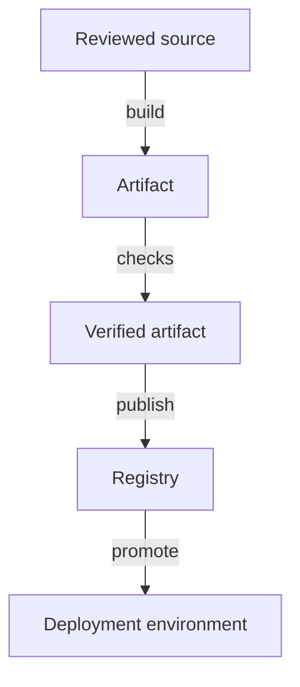

# Source Changes And Build Evidence

A developer changes the `scout` application. Source code is the human-maintained input to a build; an artifact is a packaged output ready for another stage, such as a container image. A delivery pipeline automates the steps that transform a reviewed source revision into a tested and deployable artifact.

Continuous integration (CI) combines changes frequently and runs automated checks against them. Those checks can include compilation, unit tests, integration tests and static analysis. A passing build provides evidence for the checks actually performed, not proof that every production behavior is correct.

Build identity matters. Record the source revision, dependency versions and resulting artifact digest. Rebuilding the same source later can produce different output if dependencies, base images or tools changed. Reproducibility needs control of those inputs rather than only a stable source file.

A pipeline links reviewed inputs to an identifiable artifact and the environment where it is promoted.

Building once and promoting the same artifact through environments avoids silently introducing a new build between testing and release. Environment-specific configuration can remain separate from that artifact. A staging result is more meaningful when production receives the same application bytes.

A failed check should provide useful evidence and prevent unintended promotion according to the pipeline's rules. Automatically ignoring failures makes the pipeline faster only by removing its protection. Match each check to a concrete risk and keep the build identity traceable through publication and deployment.

## Build Evidence Must Follow The Artifact

Suppose revision A passes tests using dependency version one. The pipeline later rebuilds revision A after the dependency source changes. The source revision is unchanged, but the new binary or image may differ. A release record needs both the source identity and the actual artifact identity to establish what was tested.

Pinning dependency versions, base-image identities and build tools narrows this uncertainty. Reproducible builds aim to produce the same output from the same controlled inputs. A build can still require external downloads or credentials, so the provenance of those inputs matters. A stable branch name is not a complete build-input record.

Different tests establish different evidence. Unit tests isolate selected logic. Integration tests exercise collaboration between components. End-to-end checks exercise representative paths through the system. Static analysis examines source patterns without executing every operation. Combining useful checks provides broader confidence, but none should be described as proving every possible behavior.

## Publication And Promotion Are Separate Gates

A successful local build creates an artifact where the build ran. Publication makes it available through the intended registry or repository. Deployment requires access to that published artifact and compatible runtime settings. Failure at one stage does not imply every earlier stage failed.

Promoting one digest from development verification to staging and production keeps the application bytes constant. Configuration can vary by environment through a separate reviewed input. That separation makes a failed production release easier to investigate: compare artifact identity, effective configuration and dependencies rather than wondering whether an undocumented rebuild introduced a difference.

A useful pipeline record connects revision, controlled build inputs, artifact digest, checks and promotion. This creates a chain of reviewable evidence. The goal is not maximum test count but a defensible explanation of why the exact artifact is ready for the intended environment and what still requires runtime observation.

## Common pitfalls

> [!WARNING]
> A passing pipeline proves only its configured checks passed. Rebuilding after testing can produce a different artifact unless build inputs are controlled.
