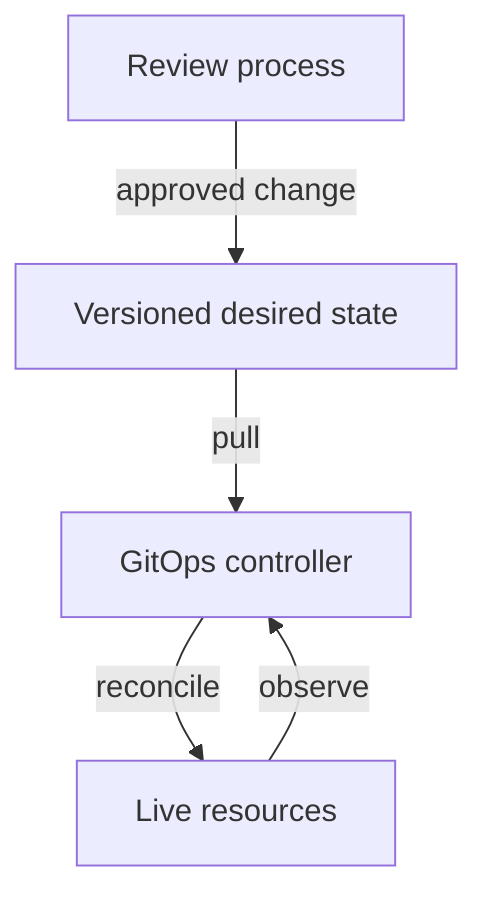

# GitOps Reconciliation And Drift

The team declares that `scout` should run version two with three replicas. GitOps is an operating approach based on declarative desired state that is versioned and immutable, pulled automatically and continuously reconciled. A repository can provide a reviewable history of intended changes, while a controller compares the declared state with the live environment.

A pull-based controller retrieves desired configuration and applies supported corrections. This differs from an administrator manually pushing each change from a workstation. The controller still needs permission to read its source and manage the intended resources, and those permissions should be scoped.

Drift is a difference between desired and live state. A manual change to the replica count can create drift. A configured controller may restore the repository value, report the difference or wait for an approved synchronization action. The exact correction behavior depends on the controller and its policy.

The controller closes differences between declared and observed resources through its configured reconciliation policy.

Storing files in Git alone does not implement GitOps. The operating workflow needs automated retrieval and reconciliation. Repository access also does not prove that the source is safe: reviews, protected identities and suitable secret handling remain necessary.

A reverted configuration can restore an earlier desired state, but it cannot necessarily undo a destructive migration or external transaction. Reconciliation manages declared resources, not every historical effect of an application. Recovery must account for the state beyond the configuration repository.

## A Drift Timeline

The desired replica count in the repository is three. An operator changes the live Deployment to five during an incident. The GitOps controller next reads its source and compares live state with the declared configuration. Under an automatic correction policy, it restores three. Under a reporting or approval policy, it can expose the difference without immediately correcting it.

The correct behavior depends on the operating contract. An emergency manual change should either be recorded in the authoritative source or handled through an explicit temporary procedure that prevents unexpected correction. Treating the live change as permanent while leaving the source unchanged creates conflicting instructions.

The controller can also fail to retrieve or apply intent. Repository credentials can expire, the source can render invalid resources, or cluster permissions can reject a change. A repository commit does not prove reconciliation happened. Status and observed resources provide evidence of whether the controller reached the expected revision.

## GitOps And Sensitive Data

A configuration repository is not automatically an appropriate place for plaintext secrets. Access to historical revisions can reveal values even after the current file removes them. Encryption or external secret delivery can support a controlled workflow, but key ownership, decryption permissions and consumer behavior remain part of the design.

Versioned history helps explain who proposed a change and when, subject to the repository's review and identity controls. It does not prove the proposed configuration was authorized by every policy or that the application result is correct. A compromised source identity can publish harmful desired state for a perfectly functioning reconciler to apply.

GitOps therefore needs trusted inputs, scoped controller permissions and runtime evidence. Its strength is a clear and repeatable intent-to-state loop, not an automatic guarantee that all declared intent is safe. Reverting a commit changes desired configuration while separate recovery may still be needed for data already modified.

## Common pitfalls

> [!WARNING]
> Git storage alone is not a reconciliation system. Manual live changes can be corrected by a controller, and reverting configuration does not automatically undo data changes.
