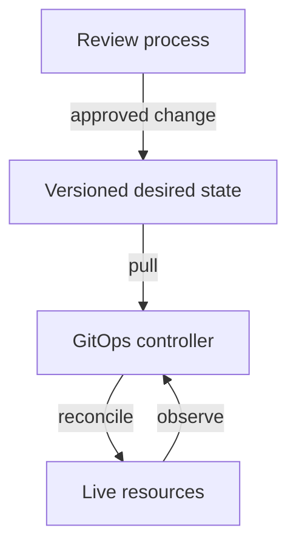

# GitOps Reconciliation And Drift

The team declares that `scout` should run in `staging` with one replica. GitOps is an operating approach based on declarative desired state that is versioned and immutable, pulled automatically and continuously reconciled. A repository can provide a reviewable history of intended changes, while a controller compares the declared state with the live environment.

A pull-based controller retrieves desired configuration and applies supported corrections. This differs from an administrator manually pushing each change from a workstation. The controller still needs permission to read its source and manage the intended resources, and those permissions should be scoped.

Drift is a difference between desired and live state. A manual change to the replica count can create drift. A configured controller may restore the repository value, report the difference or wait for an approved synchronization action. The exact correction behavior depends on the controller and its policy.



The controller closes differences between declared and observed resources through its configured reconciliation policy.

## The environment

The playground runs Argo CD as the controller and a Git server inside the cluster. The Git server holds a private repository `starfleet/scout-deploy` with a Kustomize base and two overlays, `staging` and `production`. Argo CD is installed and has no credentials and no Application yet, so nothing is delivered until you declare it.

<!-- astrona:playground:renew -->

Check that the controller and the Git server run, and that nothing is delivered:

```sh
kubectl -n argocd get deploy,statefulset
kubectl -n gitea get deploy gitea
kubectl -n argocd get applications
```

The first command lists the Argo CD server, repository server and the other components as ready. The last command prints `No resources found in argocd namespace.`

## Give the controller read access and a source

The controller needs credentials for a private repository. Argo CD reads them from a Secret with a repository label. Save this as `repo.yaml`:

```yaml
apiVersion: v1
kind: Secret
metadata:
  name: repo-scout-deploy
  namespace: argocd
  labels:
    argocd.argoproj.io/secret-type: repository
stringData:
  type: git
  url: http://gitea-http.gitea.svc:3000/starfleet/scout-deploy.git
  username: platform
  password: starfleet-gitops
```

An Application names the source in Git and the destination in the cluster. This first version has no automated policy, so the controller reports differences and does not act. Save it as `app.yaml`:

```yaml
apiVersion: argoproj.io/v1alpha1
kind: Application
metadata:
  name: scout-staging
  namespace: argocd
spec:
  project: default
  source:
    repoURL: http://gitea-http.gitea.svc:3000/starfleet/scout-deploy.git
    targetRevision: main
    path: overlays/staging
  destination:
    server: https://kubernetes.default.svc
    namespace: staging
  syncPolicy:
    syncOptions:
      - CreateNamespace=true
```

Apply both and read the status:

```sh
kubectl apply -f repo.yaml
kubectl apply -f app.yaml
sleep 15
kubectl -n argocd get application scout-staging
```

The listing shows the Application with the sync status `OutOfSync` and the health `Missing`. The controller read the repository, rendered the overlay and found resources that do not exist in the cluster. It did not create them, because no sync policy allows it. The repository has declared intent, and nothing has reconciled it. A commit alone does not deliver anything.

## Turn on reconciliation

Add the automated policy. `prune` deletes resources that disappear from Git, and `selfHeal` corrects live changes. Change the `syncPolicy` in `app.yaml` to:

```yaml
  syncPolicy:
    automated:
      prune: true
      selfHeal: true
    syncOptions:
      - CreateNamespace=true
```

Apply it and wait for the controller to reach the declared state:

```sh
kubectl apply -f app.yaml
kubectl -n staging wait --for=create deploy/scout --timeout=180s
kubectl -n staging rollout status deploy/scout --timeout=180s
kubectl -n argocd get application scout-staging
```

The Deployment `scout` appears in `staging`, and the Application now shows `Synced` and `Healthy`. Argo CD created the objects and marked them with a tracking annotation, so it knows what it owns.

## A drift timeline

The desired replica count in the repository is one. An operator changes the live Deployment to three during an incident:

```sh
kubectl -n staging scale deploy/scout --replicas=3
sleep 20
kubectl -n staging get deploy scout
```

The Deployment shows one desired replica again. With `selfHeal` on, the controller noticed the difference and restored the declared value. Under a reporting or approval policy, it would expose the difference without correcting it. The correct behavior depends on the operating contract. An emergency manual change should either be recorded in the authoritative source or handled through an explicit temporary procedure that prevents unexpected correction. Treating the live change as permanent while leaving the source unchanged creates conflicting instructions.

The controller can also fail to retrieve or apply intent. Repository credentials can expire, the source can render invalid resources, or cluster permissions can reject a change. A repository commit does not prove reconciliation happened. Read the revision that the controller reached:

```sh
kubectl -n argocd get application scout-staging -o jsonpath='{.status.sync.revision}{"\n"}'
```

The command prints the commit hash that was synced. Compare it with the head of the branch to see whether the controller reached the expected revision.

## What Git storage alone does not give

Storing files in Git alone does not implement GitOps. The operating workflow needs automated retrieval and reconciliation. Repository access also does not prove that the source is safe: reviews, protected identities and suitable secret handling remain necessary.

A reverted configuration can restore an earlier desired state, but it cannot necessarily undo a destructive migration or external transaction. Reconciliation manages declared resources, not every historical effect of an application. Recovery must account for state beyond the configuration repository.

A configuration repository is not automatically an appropriate place for plaintext secrets. Access to historical revisions can reveal values even after the current file removes them. Encryption or external secret delivery can support a controlled workflow, but key ownership, decryption permissions and consumer behavior remain part of the design. A compromised source identity can publish harmful desired state for a perfectly functioning reconciler to apply.

## What you know now

A controller pulls declared state and reconciles it. Without an automated policy it only reports `OutOfSync`. With `selfHeal` it reverts manual changes, and with `prune` it removes what Git no longer declares. The synced revision in the status is the evidence of what was reached.

## Common pitfalls

> [!WARNING]
> Git storage alone is not a reconciliation system. A commit does not prove delivery.
> Manual live changes are reverted by self-heal. Put an emergency change in Git or use an explicit temporary procedure.
> Reverting configuration does not undo data changes or external effects.
